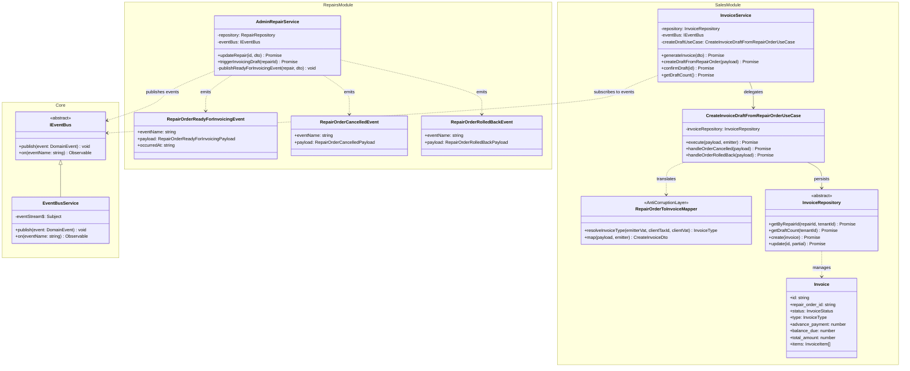

# 📘 Integración de Órdenes de Reparación y Facturación ARCA

Documentación técnica y arquitectónica de la integración entre los módulos de **Órdenes de Reparación** y **Facturación ARCA (borrador)** utilizando Clean Architecture, Tactical DDD, Clean Code, Anti-Corruption Layer (ACL) y Event-Driven Architecture en Angular.

---

## 🏛️ 1. Arquitectura y Principios de Diseño

### 1.1 Desacoplamiento Absoluto (Zero Circular Dependencies)
El módulo de **Reparaciones** (`features/repairs`) **no importa nada** del módulo de **Facturación** (`features/sales`).
La comunicación entre módulos se realiza exclusivamente a través de:
1. **`IEventBus` (DIP)**: Interfaz abstracta registrada en el inyector de dependencias (`core/events/event-bus.interface.ts`).
2. **Eventos de Dominio Inmutables**: Objetos tipados de transporte de datos (`features/repairs/domain/events/`).
3. **Anti-Corruption Layer (`RepairOrderToInvoiceMapper`)**: Ubicado en el módulo de Facturación para traducir los snapshots del evento al modelo de borrador de factura sin acoplar entidades.

### 1.2 Responsabilidad Única y Abstracción (SRP / DIP)
- **`RepairOrderReadyForInvoicingEvent`**: Transporta datos inmutables y congelados en el momento de la transición.
- **`RepairOrderToInvoiceMapper`**: Únicamente traduce y aplica reglas fiscales ARCA a los ítems y totales.
- **`CreateInvoiceDraftFromRepairOrderUseCase`**: Únicamente orquesta la persistencia, idempotencia y ciclo de vida de los borradores (`draft`, `pending_review`, `confirmed`, `stale`, `voided`).
- **`InvoiceService`**: Escucha los eventos del `IEventBus` y ejecuta los casos de uso correspondientes.

### 1.3 Principio Abierto/Cerrado (OCP - Strategy Pattern)
El mapper implementa una cadena de estrategias (`ItemMappingStrategy`) para transformar diferentes tipos de ítems:
- `LaborItemStrategy`: Mapea mano de obra obligatoria.
- `PartItemStrategy`: Mapea repuestos utilizados con su producto asociado.
- `ServiceItemStrategy`: Mapea servicios y recargos.
- `FallbackItemStrategy`: Fallback para tipos genéricos.
- `RepairOrderToInvoiceMapper.registerStrategy(newStrategy)`: Permite extender nuevos tipos de ítems (ej. instalaciones eléctricas, diagnósticos avanzados) sin modificar el código fuente existente.

---

## 🔄 2. Diagrama de Clases UML y Flujo de Eventos

---

## ⚡ 3. Flujo Operativo y Ciclo de Vida del Borrador

### 3.1 Transición a `LISTO_PARA_ENTREGAR` (Estado 5)
1. El técnico o recepcionista pasa la Orden de Reparación al estado `LISTO_PARA_ENTREGAR` (o hace click en el botón **"Generar Factura"**).
2. `AdminRepairService` emite el evento de dominio `RepairOrderReadyForInvoicingEvent` con el snapshot inmutable:
   - `customerSnapshot`: Nombre, DNI/CUIT, teléfono, email, dirección.
   - `itemsSnapshot`: Mano de obra técnica obligatoria + Repuestos utilizados.
   - `totalsSnapshot`: Costos de mano de obra, repuestos, recargo %, seña abonada, total y saldo a cobrar.
   - `warranty`, `paymentMethod`, `notes`, `technicalReport`.
3. `InvoiceService` recibe el evento a través de `IEventBus`.
4. `CreateInvoiceDraftFromRepairOrderUseCase` ejecuta la lógica **idempotente**:
   - Si no existe factura para esa orden: crea un nuevo comprobante con estado `'draft'`.
   - Si ya existe y está en `'draft'` o `'stale'` o `'pending_review'`: recalcula los ítems y totales si la orden fue modificada.
   - Si ya existe y está `'confirmed'` o `'issued'`: **no hace nada** para garantizar la inmutabilidad fiscal.
5. El tiempo de respuesta es menor a **1 segundo** sin recarga de página.

### 3.2 Cancelación (`CANCELLED` - Estado 7)
- Si una orden pasa a estado `CANCELLED`, se emite `RepairOrderCancelledEvent`.
- El caso de uso busca el borrador asociado y lo actualiza automáticamente a estado `'voided'` con nota interna de auditoría.

### 3.3 Retroceso de Estado
- Si una orden retrocede de `LISTO_PARA_ENTREGAR` a un estado anterior (ej. vuelve a diagnóstico o calidad), se emite `RepairOrderRolledBackEvent`.
- El borrador se marca como `'stale'` ("Desactualizado") para alertar visualmente al operador de que la orden fue modificada antes de confirmarse. Al volver a `LISTO_PARA_ENTREGAR`, se recalcula en fresco.

---

## ⚖️ 4. Reglas Fiscales ARCA (ex AFIP) y Ajustes

| Condición del Emisor | Condición / Identificación del Cliente | Tipo de Factura Resultante | IVA |
| :--- | :--- | :--- | :--- |
| **Monotributista** | Cualquier cliente | **Factura C** | No discriminado (0%) |
| **Responsable Inscripto** | Cliente con CUIT (11 dígitos) | **Factura A** | Discriminado al 21% |
| **Responsable Inscripto** | Consumidor Final (DNI o sin identificar) | **Factura B** | Incluido en el precio |

### 4.1 Mano de Obra Obligatoria
- Se genera una línea obligatoria de `"Mano de obra"` con la descripción del trabajo realizado (`technicalReport` o `notes`).
- El precio unitario proviene de `technical_labor_cost`.

### 4.2 Recargo por Servicio (%)
- Si la orden posee recargo (`surcharge_percentage > 0`), se aplica sobre el subtotal antes del IVA.
- Se muestra como ítem separado: `"Recargo por servicio (X%)"`.

### 4.3 Manejo de Seña / Anticipo (`advance_payment`)
- La seña abonada se registra en el campo `advance_payment`.
- **NO es un ítem de factura** (no altera los ítems gravados por ARCA).
- El saldo a cobrar al cliente se calcula como:  
  $$\text{Saldo a Cobrar} = \text{Total Factura} - \text{advance\_payment}$$
- Se visualiza claramente tanto en el banner de revisión como en el detalle de totales.

### 4.4 Validación de Umbrales ARCA al Confirmar
- Según **RG 5616/2024** y **Ley 27.743**:
  - Operaciones en efectivo $\ge \$208.644$: identificación obligatoria de cliente.
  - Operaciones electrónicas $\ge \$417.288$: identificación obligatoria de cliente.
- Las validaciones se ejecutan **al confirmar** el borrador mediante `ValidateArcaInvoiceUseCase`. Al crear el borrador inicial, no se bloquea la orden de taller para permitir trabajo fluido del técnico.

---

## 🖥️ 5. Componentes de UI / UX Incorporados

1. **`GenerateInvoiceButtonComponent`** (`src/app/admin/repairs/components/generate-invoice-button/`):
   - Botón contextual verde degradado con icono en la cabecera de la orden de reparación.
   - Permite forzar la creación del borrador en cualquier momento y redirige a la pestaña de facturación con filtro activo.
2. **Badge de Borradores Pendientes** (`src/app/admin/sales/admin-invoices-page`):
   - Pestaña / filtro rápido "Borradores Pendientes" con badge numérico animado (`pendingDraftCount`).
3. **`InvoiceDraftBannerComponent`** (`src/app/admin/sales/components/invoice-draft-banner/`):
   - Banner superior informativo en el detalle del comprobante:  
     *"Este borrador fue generado desde la Orden de Reparación #XXXX. Revísalo antes de confirmar."*
   - Desglose de seña abonada y saldo pendiente a cobrar.
   - Advertencia específica para Monotributistas: *"Como Monotributista, solo podés emitir Factura C. El IVA no se discrimina."*
   - Botón *"Confirmar Factura"* que valida reglas ARCA y cambia el estado a `'confirmed'`.

---

## 🧪 6. Cobertura de Tests Unitarios (Jest)

Suite: `src/app/features/sales/domain/usecases/create-invoice-draft-from-repair-order.usecase.spec.ts`

- **Caso 1:** Creación exitosa de borrador `draft` con datos precargados y referencias cruzadas.
- **Caso 2:** Idempotencia: el envío duplicado del evento actualiza el borrador sin duplicar registros en base de datos.
- **Caso 3:** Inmutabilidad: comprobantes ya `confirmed` o `issued` no se sobreescriben.
- **Caso 4:** Orden cancelada: borrador transiciona a `voided`.
- **Caso 5:** Retroceso de estado de orden: borrador transiciona a `stale`.
- **Caso 6:** Regla fiscal Monotributo: fuerza Factura C con IVA no discriminado.
- **Caso 7:** Regla fiscal Resp. Inscripto + CUIT: genera Factura A.
- **Caso 8:** Regla fiscal Resp. Inscripto + Consumidor Final: genera Factura B.
- **Caso 9:** Seña/Cobrado: descuenta de `balance_due` sin crear ítem espurio.
- **Caso 10:** Validación de umbral ARCA al confirmar: rechazo de Consumidor Final sin CUIT/DNI superando umbral legal.
