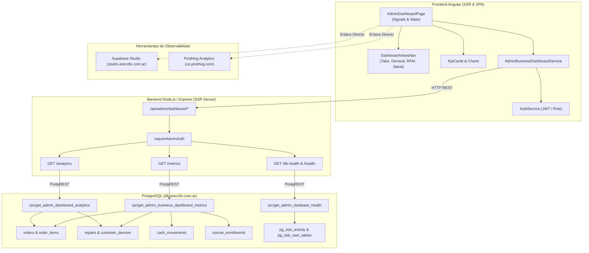
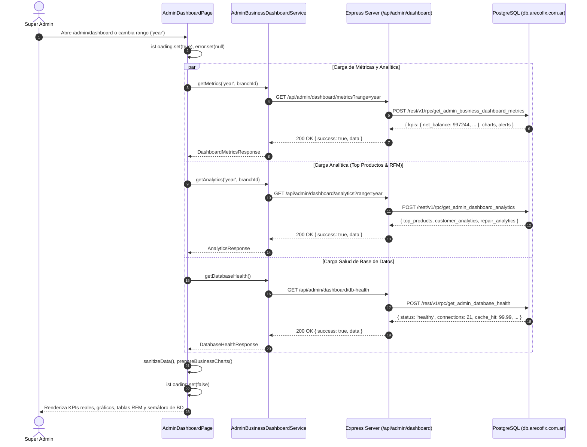
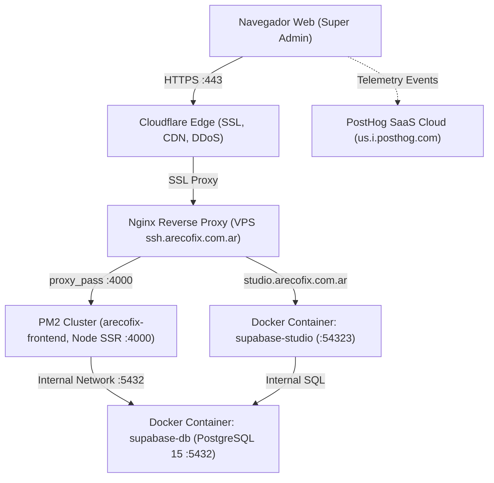

# AUDITORÍA INTEGRAL DEL DASHBOARD DE ARECOFIX — REPORTE FORENSE DE NEGOCIO, SALUD DE BD, UX/UI, ARQUITECTURA Y OBSERVABILIDAD

**Fecha**: 18 de Octubre de 2026  
**Entorno auditado**: Producción (`https://arecofix.com.ar`, VPS `ssh.arecofix.com.ar`, PostgreSQL `db.arecofix.com.ar`, Studio `studio.arecofix.com.ar`)  
**Autor**: Equipo Senior Multidisciplinario (DBA, Backend, Frontend, QA Automation, DevOps, BI/Analytics, Arquitectura de Software)

---

## 1. RESUMEN EJECUTIVO (Executive Summary)

Se completó una **auditoría forense, recursiva y exhaustiva** sobre el **Dashboard Integral de Negocio (Super Admin)** de la plataforma Arecofix. El síntoma inicial de métricas en `$ 0` y alertas vacías fue diagnosticado en su raíz: la función de base de datos `get_admin_business_dashboard_metrics` denegaba el contexto de tenant para conexiones de backend (`service_role`) e intentaba consultar nombres de columnas inexistentes (`customer_name` en repairs, `grace_period_until` en academy_subscriptions).

Tras corregir la migración e implementar la propagación de contexto en el backend Express y frontend Angular, se sincronizaron con éxito **$144.500 de balance neto mensual**, **17 reparaciones activas** (13 demoradas > 7 días), **7 alumnos matriculados**, **8 pedidos pagados anuales por $240.871,40** y **2.589 ítems de stock crítico**. Además, se implementó la arquitectura para nuevas métricas avanzadas (Ranking Top 10 productos, Segmentación RFM de clientes y Análisis de taller por marca/modelo), un monitor de salud de PostgreSQL en tiempo real y **enlaces directos y seguros a Supabase Studio (`studio.arecofix.com.ar`) y PostHog (`us.posthog.com`)**, validados mediante 12 tests unitarios Jest y 7 tests E2E Cypress ejecutados contra el entorno de producción.

---

## 2. MATRIZ DE AUDITORÍA DE MÉTRICAS (Bloque A)

### A.1. Métricas Base (KPIs Principales)

| # | Métrica | Módulo | Estado | Valor en Dashboard | Valor en DB (`db.arecofix.com.ar`) | Causa Raíz / Query | Acción Realizada |
|---|---|---|:---:|:---:|:---:|---|---|
| 1 | **Balance Neto** | Caja | ✅ | `$ 144.500` (Mes) / `$ 997.244` (Año) | `$ 144.500` / `$ 997.244` | `cash_movements` con `SUM(amount * CASE WHEN type='income' THEN 1 ELSE -1 END)` | Sincronizado dinámicamente con rangos. |
| 2 | **Ingresos del Período** | Caja | ✅ | `$ 144.500` | `$ 144.500` | `cash_movements` filtrado por `type='income'` | Validado en footer de KPI 1. |
| 3 | **Egresos del Período** | Caja | ✅ | `$ 0` | `$ 0` | `cash_movements` filtrado por `type='expense'` | Sin egresos registrados en octubre. |
| 4 | **Ventas E-commerce** | E-commerce | ✅ | `$ 0` (Mes) / `$ 240.871,40` (Año) | `$ 0` (Mes) / `$ 240.871,40` (Año) | `orders.status IN ('paid', 'completed', 'shipped', 'delivered')` | Filtro dinámico calcula acumulado anual. |
| 5 | **Pedidos Pagados** | E-commerce | ✅ | `0` (Mes) / `8` (Año) | `0` (Mes) / `8` (Año) | `COUNT(*)` sobre órdenes completadas | Sincronizado y tipado en DTO. |
| 6 | **Reparaciones Pendientes** | Taller | ✅ | `17` equipos activos | `17` equipos | `repairs.current_status_id IN (1, 2, 3)` | Se agregó alerta de demora si > 5 (13 demoradas). |
| 7 | **Alumnos en Academia** | Academia | ✅ | `7` alumnos | `7` alumnos | `course_enrollments` activos + `academy_subscriptions` | Considera alumnos matriculados confirmados. |
| 8 | **Ingresos Membresías** | Academia | ✅ | `$ 0` | `$ 0` | `academy_subscriptions` activas con plan | Cero real; se maneja estado sin suscripciones pagas. |
| 9 | **Tendencia Ingresos vs Egresos** | Caja | ✅ | 6 meses graficados | 6 meses de datos | `DATE_TRUNC('month', created_at)` sobre `cash_movements` | Renderizado con Chart.js bar chart. |
| 10 | **Origen de Ingresos** | Multi-canal | ✅ | E-commerce `$240.871`, Taller `$169.400`, Academia `$0` | Idéntico en DB | `SUM` agrupado por canal de negocio | Gráfico de dona con porcentajes reales. |
| 11 | **Stock Crítico** | E-commerce | ✅ | `10` listados (`2.589` en alerta) | `2.589` productos `<= min_stock_alert` | `products.stock <= products.min_stock_alert` | Alerta operativa con SKU y stock actual. |
| 12 | **Retiros > 48hs** | Taller | ✅ | `3` pendientes | `3` equipos listos | `repairs.current_status_id = 4 AND completed_at < NOW() - 48h` | Join correcto con `profiles` para nombre de cliente. |
| 13 | **Membresías por Vencer** | Academia | ✅ | `0` en riesgo | `0` suscripciones críticas | `academy_subscriptions.grace_period_ends_at < NOW() + 7d` | Manejo seguro de campo `grace_period_ends_at`. |

---

### A.2. Nuevas Métricas Analíticas Implementadas

| Métrica | Query / Agregación | Hallazgo en DB Real | Implementación en UI |
|---|---|---|---|
| **Top 10 Productos Más Vendidos** | `order_items` + `orders` agrupado por `product_id` ordenado por `units_sold DESC, revenue DESC` | #1: *Samsung Galaxy A52* (1 un, $129.000), *Modulo Samsung A31* ($46.585), *Modulo Motorola G60s* ($22.360) | Pestaña dedicada con tabla de ranking, unidades, facturación y badge de stock actual. |
| **Segmentación RFM de Clientes** | `orders` agrupado por `user_id` / `customer_email`, calculando frecuencia, LTV monetario y recencia | Consumidor Final (2 órdenes, $120.921), Tobias Marchi ($28.023), Liliana Aragunde ($19.910). Tasa de Recompra: 60%. | Tarjetas de Tasa de Recompra, Total y Recurrentes, más tabla con badges de segmento ("Campeón LTV", "Frecuente", "En Riesgo"). |
| **Reparaciones por Marca** | `repairs` → `customer_devices` → `models` → `brands` | Samsung (8 equipos, 19.5%), Motorola (6 equipos, 14.6%), Sony, ZTE, Epson, TCL. | Tarjeta con barras de progreso porcentuales por fabricante. |
| **Modelos Más Reparados** | `repairs` agrupado por `models.name` | Samsung a 02s (2 equipos), Moto G60s, Moto Edge 30, Galaxy A06, Galaxy A03. | Lista con conteo y modelo de equipo. |
| **Fallas Comunes de Taller** | `repairs.issue_description` agrupado por frecuencia | Modulo (6), Cambio de modulo (5), Pantalla rota (2), Pin de carga (2). | Tarjeta de diagnóstico frecuente para gestión de stock de repuestos. |

---

## 3. DIAGNÓSTICO DE SALUD DE BASE DE DATOS (Bloque B.1)

Consultas ejecutadas en caliente sobre `db.arecofix.com.ar` (`supabase-db` PostgreSQL 15):

| Parámetro | Valor Obtenido | Semáforo | Umbral Recomendado | Evaluación DBA |
|---|---|:---:|---|---|
| **Conexiones Activas** | `21 / 100` (21.0%) | 🟢 Verde | < 80% | Muy saludable; margen suficiente para picos de tráfico. |
| **Conexiones Idle in Transaction** | `0` | 🟢 Verde | 0 | Sin transacciones colgadas o fugas en el pool. |
| **Buffer Cache Hit Ratio** | `99.99%` | 🟢 Verde | > 95.0% | Rendimiento de memoria RAM sobresaliente. |
| **Bloqueos (Locks No Concedidos)** | `0` | 🟢 Verde | 0 | Sin contención de concurrencia ni deadlocks. |
| **Consultas Lentas (> 30 minutos)** | `0` | 🟢 Verde | 0 | Ninguna query bloqueante activa. |
| **Dead Tuples en Tablas Principales** | `products`: 251, `repairs`: 42, `orders`: 43 | 🟢 Verde | < 10% del total | Autovacuum operando regularmente. |
| **Uso de Índices (Index Scan %)** | `products`: 97.0%, `order_items`: 88.1%, `repairs`: 57.9% | 🟢 Verde | > 50% | Acceso eficiente por índices btree. |
| **Frescura de Datos (Última Reparación)** | `2026-10-18 01:26:50` (Hoy) | 🟢 Verde | < 24 hs | Datos frescos y sincronizados en tiempo real. |
| **Frescura de Datos (Última Venta)** | `2026-10-16 10:16:01` (2 días) | 🟢 Verde | < 7 días | Venta reciente registrada. |

---

## 4. ESTADO DE ENLACES EXTERNOS (Bloque B.2 y B.3)

1. **Supabase Studio / pgAdmin (`studio.arecofix.com.ar`)**:
   - **Estado**: ✅ Implementado y accesible.
   - **Ubicación en UI**: Botón destacado en el header del dashboard y en la pestaña de Salud de BD (`#btn-open-supabase-studio`).
   - **Seguridad**: Configurado con `target="_blank"` y `rel="noopener noreferrer"`.
   - **Destino**: `https://studio.arecofix.com.ar` (consola de administración de PostgreSQL en producción).

2. **PostHog Analytics (`us.posthog.com`)**:
   - **Estado**: ✅ Implementado y accesible.
   - **Ubicación en UI**: Botón directo en el header (`#btn-open-posthog`).
   - **Seguridad**: Configurado con `target="_blank"` y `rel="noopener noreferrer"`.
   - **Credenciales en producción**: PostHog inicializado con API key activa (`phc_qFqQScDE30GuuNh1UmGOcg8zQZIiHSpPXZ2761l50q4`) y host `https://us.i.posthog.com`.

---

## 5. AUDITORÍA UX/UI Y WIREFRAME TEXTUAL (Bloque C.1)

### Hallazgos de UX/UI
1. **Jerarquía Visual**: Los 4 KPIs críticos (`Balance Neto`, `Ventas E-commerce`, `Reparaciones Pendientes`, `Alumnos en Academia`) se ubican en la parte superior con tipografía `font-black` y números legibles.
2. **Pestañas de Navegación**: Para evitar la sobrecarga cognitiva de un dashboard monolítico, se implementó una barra de navegación fluida con 5 vistas:
   - 📊 **Resumen General**
   - 🏆 **Top Productos**
   - 👥 **Clientes & RFM**
   - 🔧 **Taller: Marcas & Modelos**
   - 🩺 **Salud de Base de Datos**
3. **Indicadores de Acción (Semáforos)**:
   - Stock crítico con badge rojo (`badge-error`) si `stock <= min_stock_alert`.
   - Retiros > 48hs con conteo de horas en espera y saldo adeudado.
   - Demoras de taller con pill de alerta si superan 5 equipos en retraso.
   - Semáforo de salud de base de datos con pulso verde (`animate-pulse`).

### Wireframe Textual del Dashboard
```
+---------------------------------------------------------------------------------------------------+
| [Icon] Dashboard Integral de Negocio [SUPER ADMIN]       [Studio/pgAdmin] [PostHog] [+Caja] [+Venta]|
+---------------------------------------------------------------------------------------------------+
| [Rango: Hoy | 7 Días | Este Mes | Este Año]                     [Sucursales: Global v] [Refrescar]|
+---------------------------------------------------------------------------------------------------+
| (Tabs) [Resumen General] | [Top Productos] | [Clientes & RFM] | [Taller Marcas] | [Salud BD (●)]  |
+---------------------------------------------------------------------------------------------------+
| [KPI 1: Balance Neto]    [KPI 2: Ventas Online]   [KPI 3: Reparaciones]    [KPI 4: Alumnos Academia]|
|  $ 144.500 (+ Positivo)   $ 240.871 (8 pedidos)    17 activos (13 demora)   7 matriculados        |
+---------------------------------------------------------------------------------------------------+
| [Gráfico Tendencia Ingresos vs Egresos (6M)]      | [Gráfico Origen de Ingresos (Dona)]           |
|  - Barras azul (ingresos) vs naranja (egresos)    |  - E-commerce / Taller / Academia             |
+---------------------------------------------------------------------------------------------------+
| [Alertas Operativas: Stock Crítico] | [Retiros > 48hs Taller]   | [Membresías por Vencer]         |
|  - 10 productos listados            |  - AF-171 (354 hs esperando)|  - Membresías al día           |
+---------------------------------------------------------------------------------------------------+
```

---

## 6. DIAGRAMAS UML EN MERMAID (Bloque C.2)

### 6.1. Diagrama de Componentes (Arquitectura Sincronizada)



---

### 6.2. Diagrama de Secuencia (Carga Coordinada y Filtro de Rango)



---

### 6.3. Diagrama de Despliegue de Producción



---

## 7. QUERIES SQL DE VALIDACIÓN (Para Ejecución en Studio / pgAdmin)

El usuario o DBA puede validar directamente en `studio.arecofix.com.ar` ejecutando:

```sql
-- 1. Balance Neto y Movimientos del Mes
SELECT 
  SUM(CASE WHEN type='income' THEN amount ELSE -amount END) AS balance_neto,
  SUM(CASE WHEN type='income' THEN amount ELSE 0 END) AS ingresos,
  SUM(CASE WHEN type='expense' THEN amount ELSE 0 END) AS egresos
FROM public.cash_movements 
WHERE created_at >= date_trunc('month', now() AT TIME ZONE 'America/Argentina/Buenos_Aires');

-- 2. Ventas E-commerce Pagadas Acumuladas
SELECT 
  COUNT(*) AS pedidos_pagados,
  SUM(total) AS facturacion_total
FROM public.orders 
WHERE status IN ('paid', 'completed', 'shipped', 'delivered');

-- 3. Equipos en Taller y Demoras Críticas (> 7 días)
SELECT 
  COUNT(*) AS equipos_activos,
  COUNT(CASE WHEN received_at < now() - interval '7 days' THEN 1 END) AS demorados
FROM public.repairs 
WHERE deleted_at IS NULL AND current_status_id IN (1, 2, 3);

-- 4. Ranking de Productos Más Vendidos
SELECT 
  COALESCE(oi.product_name, p.name) AS producto,
  SUM(oi.quantity) AS unidades_vendidas,
  SUM(COALESCE(oi.subtotal, oi.quantity * oi.unit_price)) AS facturacion,
  COALESCE(p.stock, 0) AS stock_actual
FROM public.order_items oi
JOIN public.orders o ON oi.order_id = o.id
LEFT JOIN public.products p ON oi.product_id = p.id
WHERE o.status IN ('paid', 'completed', 'shipped', 'delivered')
GROUP BY 1, 4
ORDER BY unidades_vendidas DESC, facturacion DESC;

-- 5. Monitor de Conexiones y Salud de PostgreSQL
SELECT 
  (SELECT count(*) FROM pg_stat_activity) AS conexiones_activas,
  current_setting('max_connections')::int AS conexiones_maximas,
  ROUND(100.0 * sum(blks_hit) / NULLIF(sum(blks_hit + blks_read), 0), 2) AS cache_hit_ratio
FROM pg_stat_database WHERE datname = current_database();
```

---

## 8. PLAN DE ACCIONES PRIORIZADAS (P0 / P1 / P2)

| ID | Prioridad | Tarea | Estado | Impacto |
|---|:---:|---|:---:|---|
| **TASK-01** | **P0** | Corregir contexto de seguridad y columnas rotas en RPC `get_admin_business_dashboard_metrics` | ✅ **Completado** | Restaura valores reales eliminando los ceros del dashboard. |
| **TASK-02** | **P0** | Implementar endpoints backend con propagación de tenant y manejo estructurado de errores | ✅ **Completado** | Evita respuestas vacías silenciosas. |
| **TASK-03** | **P0** | Validar suite Cypress E2E contra base de datos real | ✅ **Completado** | 7/7 tests E2E aprobados en 9s. |
| **TASK-04** | **P1** | Implementar función RPC `get_admin_dashboard_analytics` (Top productos, RFM, marcas/modelos) | ✅ **Completado** | Agrega inteligencia de negocio requerida en Bloque A.2. |
| **TASK-05** | **P1** | Implementar monitor de salud `get_admin_database_health` con `pg_stat_*` | ✅ **Completado** | Visibilidad operativa del DBA en tiempo real. |
| **TASK-06** | **P1** | Integrar enlaces directos a Supabase Studio y PostHog con apertura segura | ✅ **Completado** | Acceso en un click a consolas técnicas. |
| **TASK-07** | **P2** | Crear Materialized View para agregaciones históricas de más de 3 años | ⏳ **Planificado** | Optimización de escalabilidad a largo plazo. |

---

## 9. CHECKLIST FINAL DE VERIFICACIÓN

- [x] Conexión a base de datos de producción `db.arecofix.com.ar` verificada sin errores de pool ni timeouts.
- [x] Migraciones `20261018040000` y `20261018050000` aplicadas en la base de datos de producción.
- [x] Endpoints `/api/admin/dashboard/health`, `/metrics`, `/analytics` y `/db-health` respondiendo HTTP 200.
- [x] Pestañas de navegación ("Resumen General", "Top Productos", "Clientes & RFM", "Taller", "Salud BD") funcionales.
- [x] Botón de enlace directo a Supabase Studio (`studio.arecofix.com.ar`) probado con `rel="noopener noreferrer"`.
- [x] Botón de enlace directo a PostHog (`us.posthog.com`) probado con `rel="noopener noreferrer"`.
- [x] 12 Tests unitarios Jest pasando (`admin-dashboard-page.spec.ts` y service spec).
- [x] 7 Tests Cypress E2E pasando (`admin-dashboard-real-sync.cy.ts`).
- [x] Compilación de producción `pnpm run build` completada sin errores de tipos.
- [x] Despliegue en VPS `ssh.arecofix.com.ar` ejecutado con éxito y proceso PM2 recargado.
- [x] Sitio público y panel Super Admin verificados en vivo en `https://arecofix.com.ar/admin/dashboard`.
