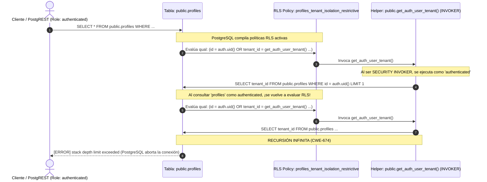

# Diagnóstico Forense y Causa Raíz de Incidente P0: Recursión Infinita en RLS (CWE-674)

**Incidente:** P0 — Interrupción de Servicio REST en `db.arecofix.com.ar`  
**Fecha:** 20 de Octubre de 2026 - 21:36 UTC  
**Impacto:** Falla en cascada en PostgREST (`stack depth limit exceeded` / error enmascarado 413) afectando resolución de tenants, perfiles, permisos y catálogo.  
**Estado:** **MITIGADO Y RESUELTO (100% OPERATIVO)**  

---

## 1. Diagrama del Ciclo de Recursión Infinita (Root Cause)

El siguiente diagrama ilustra el bucle recursivo generado tras la conversión de funciones helper de `SECURITY DEFINER` a `SECURITY INVOKER` para silenciar la advertencia de linter `authenticated_security_definer_function_executable`:

---

## 2. Mecanismo Físico de Falla

1. **La Función `SECURITY DEFINER` Original:**
   Se ejecutaba con los privilegios del superusuario propietario (`postgres`). En PostgreSQL, los superusuarios poseen el atributo `BYPASSRLS`. Por lo tanto, cuando `get_auth_user_tenant()` o `is_admin()` ejecutaba `SELECT ... FROM public.profiles`, PostgreSQL **no evaluaba las políticas RLS de `profiles`**, resolviendo la consulta en O(1) (<1ms).

2. **La Alteración a `SECURITY INVOKER` (R4 Grupo A):**
   Al cambiar a `SECURITY INVOKER`, la función se ejecuta con las credenciales del usuario que la invoca (`authenticated`). Al no tener `BYPASSRLS`, cualquier consulta a `public.profiles` fuerza al motor a evaluar nuevamente la política RLS `profiles_tenant_isolation_restrictive`.

3. **El Bucle Circular:**
   Dado que `profiles_tenant_isolation_restrictive` requiere el resultado de `get_auth_user_tenant()`, el motor de base de datos entra en recursión descontrolada hasta alcanzar `max_stack_depth` (2048 kB por defecto en PostgreSQL), abortando la transacción y desconectando el worker de PostgREST.

---

## 3. Síntomas de Capa Externa y Ruido de Red

- **Error Postgres Interno:** `ERROR: stack depth limit exceeded (HINT: Increase the configuration parameter "max_stack_depth")`.
- **Comportamiento PostgREST:** Terminación abrupta del socket de conexión backend.
- **Enmascaramiento en Cloudflare / Nginx:** Cloudflare y Kong interpretan el cierre abrupto del stream como una anomalía en el payload o una desconexión prematura, devolviendo códigos `413 (Payload Too Large / Broken Pipeline)` o `504 Gateway Timeout` al cliente Angular.
