# Plan de Remediación Priorizado de Hallazgos Supabase Database Linter

**Proyecto**: Arecofix SaaS Ecosystem  
**Fecha de Emisión**: 20 de Octubre de 2026  
**Versión**: 1.0.0-PROD-PLAN  
**Alcance**: Cluster de Base de Datos PostgreSQL 15 (`db.arecofix.com.ar` / `supabase-db`)  
**Equipo Responsable**: DBA / Database Security Engineer, Security & Compliance Auditor, SRE / DevOps Lead, QA Lead, Backend Lead  

---

## 1. Resumen Ejecutivo del Plan

El **Supabase Database Linter** arrojó un total inicial de **673 advertencias e informaciones** distribuidas en 15 reglas de seguridad, rendimiento y arquitectura. Tras el análisis forense y la toma de snapshots de línea base (FASE 0), este documento establece la **matriz completa de remediación priorizada**, detallando el código SQL UP (aplicación) y SQL DOWN (reversión transaccional), el impacto funcional, los riesgos de rollback y los tests de validación automatizados.

### Métricas de Línea Base (Pre-Remediación)

| Bloque | Categoría del Linter | Nivel | Total Inicial | Severidad Real | Prioridad |
| :--- | :--- | :--- | :---: | :---: | :---: |
| **S1** | `rls_policy_always_true` | WARN | 27 | Crítica (P0) | Fase 2.1 |
| **S1** | `anon_security_definer_function_executable` | WARN | 64 | Crítica (P0) | Fase 2.2 |
| **S1** | `authenticated_security_definer_function_executable` | WARN | 64 | Alta (P1) | Fase 2.2 |
| **S1** | `function_search_path_mutable` | WARN | 126 | Alta (P1) | Fase 2.3 |
| **S1** | `extension_in_public` | WARN | 2 | Alta (P1) | Fase 2.4 |
| **S1** | `public_bucket_allows_listing` | WARN | 90 | Alta (P1) | Fase 2.5 |
| **S1** | `pg_graphql_anon_table_exposed` | WARN | 89 | Media (P2) | Fase 2.6 |
| **S1** | `pg_graphql_authenticated_table_exposed` | WARN | 89 | Media (P2) | Fase 2.6 |
| **S2** | `rls_enabled_no_policy` | INFO | 3 | Media (P1) | Fase 3.1 |
| **S3** | `auth_rls_initplan` | WARN | 45 | Alta (P1) | Fase 4.1 |
| **S3** | `multiple_permissive_policies` | WARN | 39 | Media (P2) | Fase 4.2 |
| **S3** | `unindexed_foreign_keys` | INFO | 31 | Media (P2) | Fase 4.3 |
| **S3** | `duplicate_index` | WARN | 17 | Media (P2) | Fase 4.4 |
| **S4** | `no_primary_key` | INFO | 4 | Media (P2) | Fase 5.1 |
| **S4** | `unused_index` | INFO | 113 | Baja (P3) | Fase 5.2 |
| **TOTAL** | **Todas las categorías** | - | **673** | - | - |

---

## 2. Matriz Exhaustiva de Tareas de Remediación

```mermaid
graph TD
    A[Linter Baseline: 673 Warnings] --> B[Fase 2: Seguridad Crítica P0/P1]
    B --> B1[20261021010000: RLS Always True]
    B --> B2[20261021020000: Revoke Security Definer]
    B --> B3[20261021030000: Harden search_path]
    B --> B4[20261021040000: Extensions to extensions schema]
    B --> B5[20261021050000: Harden Storage Listing]
    B --> B6[20261021060000: Restrict GraphQL Exposure]
    A --> C[Fase 3: Políticas Faltantes P1]
    C --> C1[20261021070000: Missing RLS Policies]
    A --> D[Fase 4: Optimización Performance P1/P2]
    D --> D1[20261021080000: Auth RLS InitPlan]
    D --> D2[20261021090000: Consolidate Permissive Policies]
    D --> D3[20261021100000: Add FK Covering Indexes]
    D --> D4[20261021110000: Drop Duplicate Indexes]
    A --> E[Fase 5: Higiene de Esquema P2/P3]
    E --> E1[20261021120000: Deduplicate & Add Missing PKs]
    E --> E2[20261021130000: Drop Safe Unused Indexes]
    B & C & D & E --> F[Fase 6: Verificación E2E / Jest / Linter Post-Audit]
```



---

### Bloque S1: Seguridad Crítica (P0 / P1)

#### Tarea REM-S1.1-01: Remediación de `rls_policy_always_true` en `cola_tiktok`
- **Categoría**: `rls_policy_always_true`
- **Objeto**: `public.cola_tiktok`
- **Políticas Afectadas**: 
  - `Permitir inserción en cola_tiktok` (INSERT, WITH CHECK true)
  - `Permitir lectura de cola_tiktok a roles de servicio` (SELECT, USING true)
  - `Permitir actualización de cola_tiktok a roles de servicio` (UPDATE, USING true)
- **Severidad Real**: P0 (Cualquier rol anónimo o autenticado puede mutar o inyectar payloads en la cola de videos).
- **Impacto Funcional**: Nulo para usuarios legítimos; restringe las mutaciones exclusivamente a `service_role` o administradores del sistema.
- **Estrategia**:
  - `UP`: Dropear políticas que usan `true` sin filtrar por rol; recrear políticas restringidas a `service_role` y `is_super_admin()`.
  - `DOWN`: Restaurar políticas originales permisivas.
- **Validación**: Consulta REST anónima intentando `POST /cola_tiktok` debe retornar `HTTP 401/403`.

#### Tarea REM-S1.1-02: Remediación de `rls_policy_always_true` en `course_certificates`
- **Categoría**: `rls_policy_always_true`
- **Objeto**: `public.course_certificates`
- **Políticas Afectadas**: 
  - `Instructors can insert course_certificates` (INSERT, WITH CHECK true)
  - `Public can view course_certificates` / `Public can verify certificates` (SELECT, USING true)
- **Severidad Real**: P0 (Permite a cualquier usuario autenticado emitir certificados de cualquier curso y estudiante).
- **Impacto Funcional**: Nulo. Los instructores solo pueden emitir certificados de los cursos que efectivamente dictan (`instructor_id = (SELECT auth.uid())`); la lectura pública se unifica para permitir verificar por `id` exacto o estado `valid`.
- **Estrategia**: Reemplazar WITH CHECK con validación de instructor/admin y consulta acotada.

#### Tarea REM-S1.1-03: Remediación de `rls_policy_always_true` en `service_leads`
- **Categoría**: `rls_policy_always_true`
- **Objeto**: `public.service_leads`
- **Políticas Afectadas**: `service_leads_anon_insert` (INSERT, WITH CHECK true)
- **Severidad Real**: P0 (Inyección de registros basura o spam sin validación de integridad).
- **Impacto Funcional**: Nulo para leads válidos; exige que el lead contenga nombre válido, teléfono o email, y `tenant_id` no nulo.
- **Estrategia**:
  ```sql
  WITH CHECK (
    tenant_id IS NOT NULL 
    AND name IS NOT NULL 
    AND length(trim(name)) >= 2 
    AND (phone IS NOT NULL OR email IS NOT NULL)
  );
  ```

#### Tarea REM-S1.1-04: Remediación de `rls_policy_always_true` en esquema `zarx`
- **Categoría**: `rls_policy_always_true`
- **Objeto**: `zarx.*` (`active_news`, `emergencies`, `profiles`, `reports`, etc.)
- **Políticas Afectadas**: `zarx_*_all` con `FOR ALL USING (true) WITH CHECK (true)`
- **Severidad Real**: P0 (Exposición total de mutación y lectura abierta para proyecto secundario).
- **Estrategia**: Dropear políticas `ALL USING (true)` y restringir el esquema `zarx` a roles autenticados de zarx o propietarios, revocando acceso anónimo no autenticado.

---

#### Tarea REM-S1.2-01: Hardening de Triggers y Hooks (`anon_security_definer_function_executable`)
- **Categoría**: `anon_security_definer_function_executable` / `authenticated_security_definer_function_executable`
- **Objetos**: Funciones trigger de base de datos (`auto_assign_*_branch`, `fn_sync_d1_webhook`, `handle_new_user`, `sync_order_items_stock`, `update_order_total`, `custom_access_token_hook`).
- **Severidad Real**: P0 (Funciones internas de PostgreSQL ejecutables por cualquier cliente vía `/rpc/*`).
- **Estrategia**:
  - `REVOKE EXECUTE ON FUNCTION ... FROM public, anon, authenticated;`
  - Para `custom_access_token_hook`: `GRANT EXECUTE TO supabase_auth_admin;`
  - Para cron jobs (`delete_old_audit_logs`, `expire_stale_enrollments`): `GRANT EXECUTE TO service_role;`
- **Validación**: Intentar ejecutar `POST /rpc/delete_old_audit_logs` con anonKey retorna `HTTP 401/404` (Function not found / Permission denied).

#### Tarea REM-S1.2-02: Hardening de Funciones Administrativas y RLS Helpers
- **Objetos**: `create_employee`, `assign_user_as_employee`, `admin_revoke_certificate`, `get_admin_database_health`, `get_financial_analytics_v3`, `is_super_admin`, `is_admin`, etc.
- **Severidad Real**: P0 / P1
- **Estrategia**:
  - `REVOKE EXECUTE FROM anon, public;`
  - `GRANT EXECUTE TO authenticated;`
  - Incorporar validación defensiva en el cuerpo:
    ```sql
    IF NOT public.is_admin() THEN 
      RAISE EXCEPTION 'Acceso denegado: se requieren privilegios administrativos.'; 
    END IF;
    ```
- **Falsos Positivos Justificados**:
  - `public.get_repair_tracking(p_code text)`: Requiere `SECURITY DEFINER` para permitir a clientes rastrear su orden de reparación sin otorgar `SELECT` general a la tabla `repairs`. Se añade validación estricta de parámetros y `search_path = public, pg_temp`.
  - `public.get_public_certificate_data(p_cert_id uuid)`: Requiere `SECURITY DEFINER` para verificación pública de diplomas.

---

#### Tarea REM-S1.4-01: Inmutabilidad de `search_path` en Funciones (`function_search_path_mutable`)
- **Categoría**: `function_search_path_mutable`
- **Objetos**: 126 funciones en `public` y `zarx`.
- **Severidad Real**: P1 (Prevención de ataques de Schema Hijacking / Trojan Search Path).
- **Estrategia**:
  - Aplicar `ALTER FUNCTION <fn>(<args>) SET search_path = public, pg_temp;` (o `''` según aplique) a las 126 funciones.

---

#### Tarea REM-S1.5-01: Migración de Extensiones a Esquema Privado (`extension_in_public`)
- **Categoría**: `extension_in_public`
- **Objetos**: `pg_net`, `unaccent`.
- **Severidad Real**: P1 (Buenas prácticas y aislamiento de objetos de sistema).
- **Estrategia**:
  ```sql
  CREATE SCHEMA IF NOT EXISTS extensions;
  ALTER EXTENSION pg_net SET SCHEMA extensions;
  ALTER EXTENSION unaccent SET SCHEMA extensions;
  ```
- **Validación**: `SELECT count(*) FROM pg_extension WHERE extnamespace::regnamespace::text = 'public';` retorna `0`.

---

#### Tarea REM-S1.6-01: Blindaje de Listado Público en Storage (`public_bucket_allows_listing`)
- **Categoría**: `public_bucket_allows_listing`
- **Objetos**: Buckets `academy_certificates`, `avatars`, `course-covers`, `cv-generados`, `evidence`.
- **Severidad Real**: P1 (Listado no autorizado de archivos privados o masivos).
- **Estrategia**:
  - Dropear políticas `SELECT` con `bucket_id = '...'` asignadas a `public` en `storage.objects`.
  - Los buckets con `public = true` continúan sirviendo descargas directas por URL fija vía Supabase CDN.
  - Para `cv-generados` y `evidence`: Restringir `SELECT` a usuarios autenticados / administradores.

---

#### Tarea REM-S1.7-01 & REM-S1.8-01: Restricción de Exposición en GraphQL
- **Categoría**: `pg_graphql_anon_table_exposed` y `pg_graphql_authenticated_table_exposed`
- **Severidad Real**: P2
- **Estrategia**:
  - Arecofix utiliza exclusivamente la API REST de PostgREST y no consume GraphQL.
  - Revocar `ALL` a `anon` en tablas puramente internas (`audit_logs`, `auth_logs`, `invoices`, `bank_reconciliations`, `purchases`, `schema_migrations`, `zarx.*`).
  - Desactivar o despublicar el esquema `graphql_public` para roles anónimos.

---

### Bloque S2: Seguridad Media / Políticas Faltantes (P1)

#### Tarea REM-S2.1-01: Definición de Políticas RLS Faltantes
- **Categoría**: `rls_enabled_no_policy`
- **Objetos**: `public.educacion_y_skills`, `public.experiencia_laboral`, `public.schema_migrations`.
- **Severidad Real**: P1 (Tablas con RLS habilitado pero sin políticas aplicadas).
- **Estrategia**:
  - Para `educacion_y_skills` y `experiencia_laboral`: Habilitar lectura pública (`FOR SELECT TO anon, authenticated USING (true)`) y administración restringida (`is_super_admin()`).
  - Para `schema_migrations`: Aislar a `service_role` y `is_super_admin()`.

---

### Bloque S3: Rendimiento y Optimización de Consultas (P1 / P2)

#### Tarea REM-S3.1-01: Optimización de `auth_rls_initplan` (Subconsultas Escalares)
- **Categoría**: `auth_rls_initplan`
- **Objetos**: 45 políticas en `profiles`, `orders`, `course_certificates`, `academy_payments`, etc.
- **Severidad Real**: P1 (Degradación de latencia en consultas con RLS por evaluación de funciones volátiles por fila).
- **Estrategia**: Reemplazar expresiones directas `auth.uid() = ...` por subconsultas escalares `(SELECT auth.uid()) = ...`.

#### Tarea REM-S3.2-01: Consolidación de Múltiples Políticas Permisivas
- **Categoría**: `multiple_permissive_policies`
- **Objetos**: 39 agrupaciones en `profiles`, `orders`, `repairs`, etc.
- **Severidad Real**: P2 (Evaluación redundante de cláusulas `OR` en el planificador de PostgreSQL).
- **Estrategia**: Fusionar políticas permisivas redundantes del mismo comando y rol en una única política comprensiva.

#### Tarea REM-S3.3-01: Creación de Índices para Foreign Keys Huérfanas
- **Categoría**: `unindexed_foreign_keys`
- **Objetos**: 31 restricciones FK sin índice de cobertura (`products_branch_id_fkey`, `repairs_supplier_id_fkey`, etc.).
- **Severidad Real**: P2 (Bloqueos de tabla y scans secuenciales en JOINs y cascades).
- **Estrategia**: `CREATE INDEX IF NOT EXISTS idx_<table_column> ON public.<table>(<column>);`.

#### Tarea REM-S3.4-01: Eliminación de Índices Duplicados
- **Categoría**: `duplicate_index`
- **Objetos**: 17 índices idénticos en `course_lessons`, `course_modules`, `courses`, `product_stock_per_branch`, `repairs`, `schema_migrations`.
- **Severidad Real**: P2 (Sobrecarga de I/O en cada INSERT/UPDATE).
- **Estrategia**: `DROP INDEX IF EXISTS public.<idx>;`, conservando el índice que respalda la constraint UNIQUE/PK.

---

### Bloque S4: Higiene de Esquema y Almacenamiento (P2 / P3)

#### Tarea REM-S4.1-01: Deduplicación y Claves Primarias Faltantes
- **Categoría**: `no_primary_key`
- **Objetos**: `course_certificates`, `course_enrollments`, `services_backup_20261018`, `blog_posts_backup_20261018`.
- **Severidad Real**: P2 (Falta de integridad de entidad e imposibilidad de replicación lógica).
- **Estrategia**:
  - Deduplicar `course_certificates` (7 registros con 3 copias idénticas) mediante filtro por `ctid`.
  - Agregar `PRIMARY KEY (id)` a `course_certificates` y `course_enrollments`.
  - Mover las tablas de backup al esquema `backups` (`ALTER TABLE ... SET SCHEMA backups;`).

#### Tarea REM-S4.2-01: Depuración de Índices Inutilizados Seguros
- **Categoría**: `unused_index`
- **Objetos**: Índices con `idx_scan = 0` que no respaldan restricciones FK ni UNIQUE.
- **Severidad Real**: P3
- **Estrategia**: Eliminar únicamente los índices redundantes o de pruebas verificados en `pg_stat_user_indexes`.

---

## 3. Cronograma de Despliegue de Migraciones

| Archivo de Migración | Bloque | Descripción | Modo Transaccional |
| :--- | :---: | :--- | :---: |
| `20261021010000_fix_rls_always_true.sql` | S1.1 | Hardening de políticas con `true` en cola, certificados, leads y zarx | `BEGIN ... COMMIT` |
| `20261021020000_revoke_anon_security_definer.sql` | S1.2 / S1.3 | Revocación de privilegios `EXECUTE` en funciones `SECURITY DEFINER` | `BEGIN ... COMMIT` |
| `20261021030000_harden_function_search_path.sql` | S1.4 | Fijación explícita de `SET search_path` en todas las funciones | `BEGIN ... COMMIT` |
| `20261021040000_move_extensions_out_of_public.sql` | S1.5 | Reubicación de `pg_net` y `unaccent` en esquema `extensions` | `BEGIN ... COMMIT` |
| `20261021050000_harden_storage_buckets.sql` | S1.6 | Restricción de listado de buckets públicos en `storage.objects` | `BEGIN ... COMMIT` |
| `20261021060000_restrict_graphql_exposure.sql` | S1.7 / S1.8 | Aislamiento de esquemas y tablas frente a PostgREST/GraphQL | `BEGIN ... COMMIT` |
| `20261021070000_rls_policies_missing_tables.sql` | S2.1 | Adición de políticas RLS para tablas huérfanas (`educacion_y_skills`) | `BEGIN ... COMMIT` |
| `20261021080000_optimize_rls_initplan.sql` | S3.1 | Reescritura a `(SELECT auth.uid())` en políticas RLS | `BEGIN ... COMMIT` |
| `20261021090000_consolidate_permissive_policies.sql` | S3.2 | Consolidación de políticas permisivas redundantes | `BEGIN ... COMMIT` |
| `20261021100000_add_fk_indexes.sql` | S3.3 | Creación de índices btree sobre 31 claves foráneas | Individual / Idempotente |
| `20261021110000_drop_duplicate_indexes.sql` | S3.4 | Eliminación de 17 índices duplicados redundantes | Individual / Idempotente |
| `20261021120000_add_missing_primary_keys.sql` | S4.1 | Deduplicación de certificados, PKs y traslado de backups a `backups` | `BEGIN ... COMMIT` |
| `20261021130000_drop_safe_unused_indexes.sql` | S4.2 | Depuración de índices obsoletos no utilizados | Individual / Idempotente |

---

## 4. Criterios de Aceptación y Validación Post-Remediación

1. **Supabase Linter**: 0 warnings de categorías críticas (`rls_policy_always_true`, `function_search_path_mutable`, `extension_in_public`, `public_bucket_allows_listing`, `rls_enabled_no_policy`, `auth_rls_initplan`, `duplicate_index`, `no_primary_key`).
2. **Excepciones Justificadas**: Únicamente `get_public_certificate_data` y `get_repair_tracking` conservan `SECURITY DEFINER` para acceso anónimo acotado y seguro.
3. **Pruebas de Regresión**:
   - Jest Unit Tests: **276 / 276 passing** (100%).
   - Cypress E2E Tests: **10 / 10 passing** (100%).
   - Validación de Contrato de Esquema: `node scripts/verify-schema.mjs` -> **200 OK**.
   - CSP Enforced: Activo y sin Report-Only.
