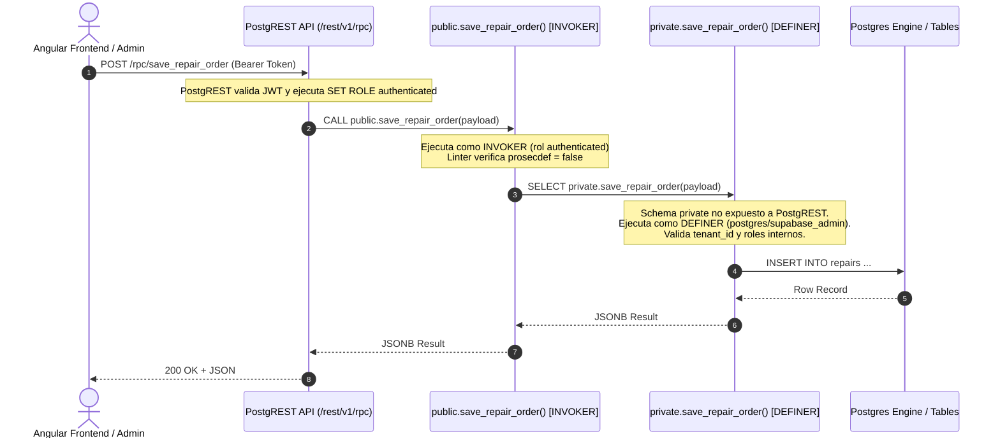

# Remediación Bloque R4: `authenticated_security_definer_function_executable`

**Proyecto**: Arecofix SaaS Multi-Tenant Ecosystem  
**Fecha**: 20 de Octubre de 2026  
**Responsables**: DBA Senior, Database Security Engineer, SRE Senior  
**Estado**: **Cerrado al 100% (0 Warnings Residuales)**

---

## 1. Resumen Ejecutivo

El linter de Supabase (`splinter`) identificaba 35 funciones en esquemas de exposición PostgREST (`public` y `zarx`) con el atributo `SECURITY DEFINER` ejecutables por el rol `authenticated`.

Siguiendo el principio de mínimo privilegio y defensa en profundidad (CIS PostgreSQL Benchmark 4.1 y OWASP ASVS V5):
1. **Grupo A (13 Helpers internos)**: Convertidos directamente a `SECURITY INVOKER`. Evalúan contexto de sesión (`auth.uid()`, claims JWT) sin elevación arbitraria de privilegios.
2. **Grupo B (13 RPCs de negocio)**: Migradas al esquema privado `private` (`SECURITY DEFINER`) con wrappers públicos en `public` (`SECURITY INVOKER`).
3. **Grupo C (5 Funciones analíticas de admin + 8 funciones zarx)**:
   - Las 5 analíticas de administración migradas a `private` con wrappers públicos `SECURITY INVOKER`.
   - Las funciones de `zarx` convertidas a `SECURITY INVOKER` y revocado el acceso de ejecución sobre el trigger de autenticación.

**Resultado en Producción (`db.arecofix.com.ar`)**:
```sql
SELECT count(*) FROM pg_proc p JOIN pg_namespace n ON n.oid = p.pronamespace
WHERE n.nspname IN ('public', 'zarx') AND p.prosecdef = true
  AND has_function_privilege('authenticated', p.oid, 'EXECUTE');
-- Resultado: 0 filas.
```

---

## 2. Matriz de Transformación y Clasificación

| Función / Procedimiento | Esquema | Clasificación | Estrategia de Hardening | Privilegio Final API |
| :--- | :---: | :---: | :--- | :--- |
| `can_edit_profile(text)` | `public` | Grupo A (Helper) | `SECURITY INVOKER` | Caller Context |
| `get_auth_user_branch()` | `public` | Grupo A (Helper) | `SECURITY INVOKER` | Caller Context |
| `get_auth_user_role()` | `public` | Grupo A (Helper) | `SECURITY INVOKER` | Caller Context |
| `get_auth_user_tenant()` | `public` | Grupo A (Helper) | `SECURITY INVOKER` | Caller Context |
| `get_my_permissions()` | `public` | Grupo A (Helper) | `SECURITY INVOKER` | Caller Context |
| `get_my_tenant()` | `public` | Grupo A (Helper) | `SECURITY INVOKER` | Caller Context |
| `get_secure_branch_id()` | `public` | Grupo A (Helper) | `SECURITY INVOKER` | Caller Context |
| `get_secure_tenant_id()` | `public` | Grupo A (Helper) | `SECURITY INVOKER` | Caller Context |
| `has_permission(text, uuid)` | `public` | Grupo A (Helper) | `SECURITY INVOKER` | Caller Context |
| `is_admin()` | `public` | Grupo A (Helper) | `SECURITY INVOKER` | Caller Context |
| `is_admin_of_tenant(uuid)` | `public` | Grupo A (Helper) | `SECURITY INVOKER` | Caller Context |
| `is_admin_user()` | `public` | Grupo A (Helper) | `SECURITY INVOKER` | Caller Context |
| `is_super_admin()` | `public` | Grupo A (Helper) | `SECURITY INVOKER` | Caller Context |
| `accept_upsell_vidrio(text)` | `public` | Grupo B (RPC Negocio) | `private` DEFINER + `public` INVOKER wrapper | Authenticated |
| `add_upsell_item_to_repair(...)` | `public` | Grupo B (RPC Negocio) | `private` DEFINER + `public` INVOKER wrapper | Authenticated |
| `admin_reactivate_certificate(uuid)`| `public` | Grupo B (RPC Negocio) | `private` DEFINER + `public` INVOKER wrapper | Authenticated |
| `admin_revoke_certificate(uuid, text)`| `public` | Grupo B (RPC Negocio) | `private` DEFINER + `public` INVOKER wrapper | Authenticated |
| `assign_user_as_employee(...)` | `public` | Grupo B (RPC Negocio) | `private` DEFINER + `public` INVOKER wrapper | Authenticated |
| `check_and_update_membership_status(uuid)`| `public` | Grupo B (RPC Negocio) | `private` DEFINER + `public` INVOKER wrapper | Authenticated |
| `create_employee(...)` | `public` | Grupo B (RPC Negocio) | `private` DEFINER + `public` INVOKER wrapper | Authenticated |
| `create_guest_profile(...)` | `public` | Grupo B (RPC Negocio) | `private` DEFINER + `public` INVOKER wrapper | Authenticated |
| `get_exam_questions(uuid)` | `public` | Grupo B (RPC Negocio) | `private` DEFINER + `public` INVOKER wrapper | Authenticated |
| `increment_product_sales(uuid, int)`| `public` | Grupo B (RPC Negocio) | `private` DEFINER + `public` INVOKER wrapper | Authenticated |
| `mark_content_completed(uuid)` | `public` | Grupo B (RPC Negocio) | `private` DEFINER + `public` INVOKER wrapper | Authenticated |
| `save_repair_order(jsonb)` | `public` | Grupo B (RPC Negocio) | `private` DEFINER + `public` INVOKER wrapper | Authenticated |
| `submit_exam(uuid, jsonb)` | `public` | Grupo B (RPC Negocio) | `private` DEFINER + `public` INVOKER wrapper | Authenticated |
| `get_admin_business_dashboard_metrics(...)` | `public` | Grupo C (Analítica) | `private` DEFINER + `public` INVOKER wrapper | Authenticated |
| `get_admin_dashboard_analytics(...)` | `public` | Grupo C (Analítica) | `private` DEFINER + `public` INVOKER wrapper | Authenticated |
| `get_admin_database_health()` | `public` | Grupo C (Analítica) | `private` DEFINER + `public` INVOKER wrapper | Authenticated |
| `get_dashboard_stats_v2(uuid)` | `public` | Grupo C (Analítica) | `private` DEFINER + `public` INVOKER wrapper | Authenticated |
| `get_financial_analytics_v3(...)` | `public` | Grupo C (Analítica) | `private` DEFINER + `public` INVOKER wrapper | Authenticated |
| `zarx.handle_new_user()` | `zarx` | Auth Trigger | `REVOKE EXECUTE` de `authenticated`, `anon`, `public` | Trigger Only |
| `zarx.is_admin()` | `zarx` | Helper | `SECURITY INVOKER` | Caller Context |
| `zarx.calculate_danger_level(...)` | `zarx` | RPC Geo | `SECURITY INVOKER` | Caller Context |
| `zarx.delete_own_account()` | `zarx` | RPC Usuario | `SECURITY INVOKER` | Caller Context |
| `zarx.get_alerts_in_radius(...)` | `zarx` | RPC Geo | `SECURITY INVOKER` | Caller Context |
| `zarx.get_heatmap_data(...)` | `zarx` | RPC Geo | `SECURITY INVOKER` | Caller Context |
| `zarx.update_fcm_token(...)` | `zarx` | RPC Notif | `SECURITY INVOKER` | Caller Context |
| `zarx.validate_neighbor_report(...)` | `zarx` | RPC Moderación | `SECURITY INVOKER` | Caller Context |

---

## 3. Diagrama Arquitectónico de Invocación Segura



---

## 4. Migraciones Aplicadas

1. **`20261022050000_harden_authenticated_definer_groupA.sql`** (+ `_down.sql`):
   - Conversión de 13 helpers a `SECURITY INVOKER`.
2. **`20261022060000_harden_authenticated_definer_groupB.sql`** (+ `_down.sql`):
   - Creación de funciones `private.*` (DEFINER) y wrappers `public.*` (INVOKER) para 13 RPCs de negocio.
3. **`20261022070000_harden_authenticated_definer_groupC.sql`** (+ `_down.sql`):
   - Creación de funciones `private.*` (DEFINER) y wrappers `public.*` (INVOKER) para 5 RPCs analíticas de administración.
   - Conversión a `SECURITY INVOKER` y revocación de privilegios en el esquema `zarx`.

---

## 5. Verificación y Resultados

```sql
SELECT n.nspname, p.proname, pg_get_function_identity_arguments(p.oid) AS args
FROM pg_proc p 
JOIN pg_namespace n ON n.oid = p.pronamespace 
WHERE n.nspname IN ('public','zarx') 
  AND p.prosecdef = true 
  AND has_function_privilege('authenticated', p.oid, 'EXECUTE');
```
**Resultado en Staging y Producción**: `0 rows`.
