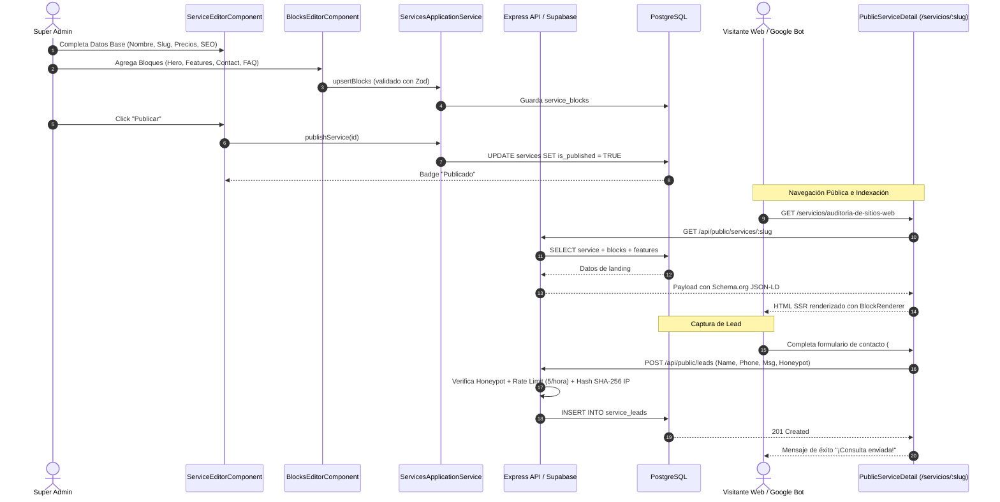
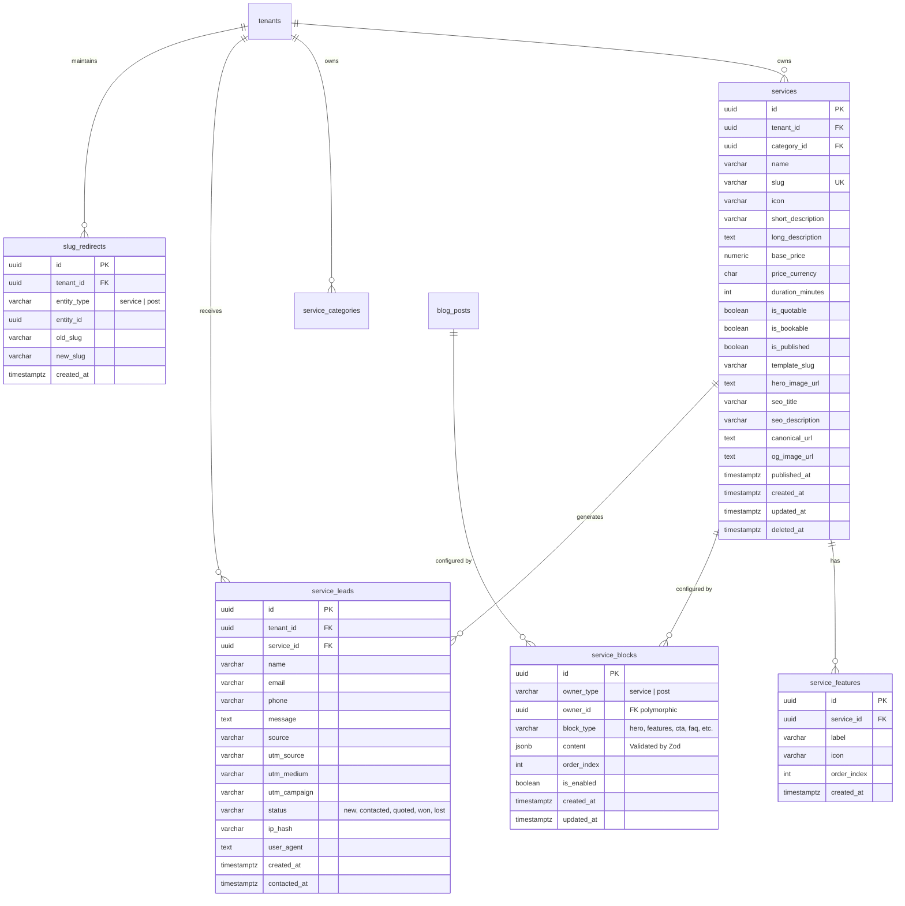

# Arquitectura Técnica — Creador de Landing Pages de Servicios (Opción C - Híbrido)

**Fecha:** 18 de Octubre de 2026  
**Autor:** Equipo de Arquitectura de Software & DBA Arecofix  
**Patrón:** Clean Architecture + Tactical DDD + Modular Blocks  

---

## 1. Diagrama de Componentes (Clean Architecture)

```mermaid
graph TB
    subgraph "Frontend Layer (Angular 21 Standalone + SSR)"
        AdminServices[AdminServicesPage<br/>/admin/services]
        ServiceEditor[ServiceEditorComponent<br/>/admin/services/:id/edit]
        BlocksEditor[BlocksEditorComponent<br/>Shared with Blog & Services]
        AdminLeads[AdminLeadsPage<br/>/admin/leads]
        PublicList[PublicServicesListComponent<br/>/servicios]
        PublicDetail[PublicServiceDetailComponent<br/>/servicios/:slug]
        BlockRenderer[BlockRendererComponent<br/>Shared Production SSR Renderer]
    end

    subgraph "Application Layer (Use Cases & Mappers)"
        SvcApp[ServicesApplicationService]
        CreateSvc[CreateServiceUseCase]
        PublishSvc[PublishServiceUseCase]
        UpsertBlocks[UpsertBlocksUseCase]
        CreateLead[CreateLeadUseCase]
        SvcMapper[ServiceMapper / JSON-LD]
    end

    subgraph "Domain Layer (Entities, VOs & Contracts)"
        ServiceEntity[Service Entity]
        BlockEntity[ServiceBlock Entity]
        LeadEntity[ServiceLead Entity]
        SlugVO[Slug Value Object]
        MoneyVO[Money Value Object]
        SeoVO[SeoMeta Value Object]
        ZodSchemas[Zod BlockSchemasByType]
        ISvcRepo[ServiceRepository]
        IBlockRepo[ServiceBlockRepository]
        ILeadRepo[ServiceLeadRepository]
    end

    subgraph "Infrastructure & Backend Layer"
        SupabaseSvcRepo[SupabaseServiceRepository]
        SupabaseBlockRepo[SupabaseServiceBlockRepository]
        SupabaseLeadRepo[SupabaseServiceLeadRepository]
        ExpressServer[Node Express SSR Server<br/>server.ts]
        ServicesRoutes[Services Express API<br/>server/routes/services.routes.ts]
        SitemapRoutes[Sitemap XML Routes<br/>server/routes/sitemap.routes.ts]
    end

    subgraph "Persistence Layer (PostgreSQL - Docker supabase-db)"
        DbServices[(public.services)]
        DbBlocks[(public.service_blocks)]
        DbFeatures[(public.service_features)]
        DbLeads[(public.service_leads)]
        DbRedirects[(public.slug_redirects)]
    end

    AdminServices --> SvcApp
    ServiceEditor --> SvcApp
    ServiceEditor --> BlocksEditor
    BlocksEditor --> BlockRenderer
    PublicList --> SvcApp
    PublicDetail --> SvcApp
    PublicDetail --> BlockRenderer
    AdminLeads --> SvcApp

    SvcApp --> CreateSvc
    SvcApp --> PublishSvc
    SvcApp --> UpsertBlocks
    SvcApp --> CreateLead

    CreateSvc --> ISvcRepo
    PublishSvc --> ISvcRepo
    PublishSvc --> IBlockRepo
    UpsertBlocks --> IBlockRepo
    CreateLead --> ILeadRepo

    SupabaseSvcRepo -.->|Implements| ISvcRepo
    SupabaseBlockRepo -.->|Implements| IBlockRepo
    SupabaseLeadRepo -.->|Implements| ILeadRepo

    ExpressServer --> ServicesRoutes
    ExpressServer --> SitemapRoutes

    ServicesRoutes --> DbServices
    ServicesRoutes --> DbBlocks
    ServicesRoutes --> DbLeads
    ServicesRoutes --> DbRedirects
    SupabaseSvcRepo --> DbServices
    SupabaseBlockRepo --> DbBlocks
    SupabaseLeadRepo --> DbLeads
```

---

## 2. Diagrama de Secuencia: Flujo Integral de Vida del Servicio

---

## 3. Modelo Entidad-Relación (ERD)

