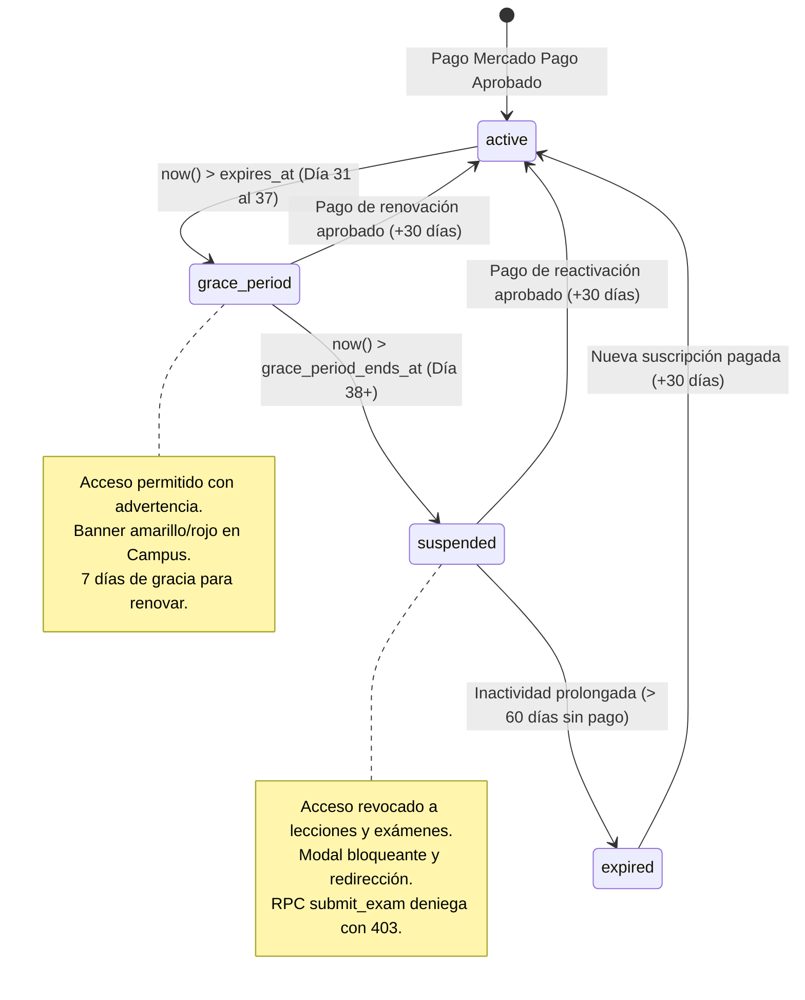

# 💳 Arecofix Academy — Diseño de Arquitectura y Esquema de Membresías

**Fecha:** 17 de Octubre de 2026  
**Módulo:** Cobro y Gestión Automatizada de Membresías (`/academy`, `/admin/academy/subscriptions`, `/student`)  
**Integración:** Mercado Pago (Checkout Pro & Webhooks) + PostgreSQL Supabase (RLS & RPCs)  
**Regla de Oro:** El frontend **NUNCA** otorga acceso de forma autónoma. El motor de base de datos (PostgreSQL RLS y RPCs) y los Webhooks firmados de Mercado Pago son la **única fuente de verdad** para activar, prorrogar o revocar membresías.

---

## 1. Auditoría del Mercado Pago Existente (E-commerce)

Se auditó la implementación actual de Mercado Pago ubicada en `server/routes/mercadopago.routes.ts`:
- **Modalidad:** **Checkout Pro** mediante la API de Preferencias (`https://api.mercadopago.com/checkout/preferences`).
- **Autenticación:** Utiliza `MP_ACCESS_TOKEN` / `MERCADOPAGO_ACCESS_TOKEN` en variables de entorno.
- **Validación de Firma:** Función criptográfica `verifyMpSignature(xSignature, xRequestId, dataId, secret)` que valida el encabezado `x-signature` con HMAC-SHA256 y comparación segura de tiempos (`crypto.timingSafeEqual`).
- **Idempotencia:** Registra y consulta la tabla `payments` antes de procesar cualquier notificación duplicada.
- **Aislamiento Total:** El flujo de Academy dispondrá de sus propias rutas independientes (`/api/academy/subscribe` y `/api/webhooks/mercadopago-academy`), compartiendo únicamente las funciones utilitarias criptográficas sin modificar ninguna línea del E-commerce ni de Reparaciones.

---

## 2. Esquema Relacional de Base de Datos

### 2.1 Tabla `public.academy_plans`
Almacena los planes de suscripción configurables sin precios hardcodeados.

```sql
CREATE TABLE IF NOT EXISTS public.academy_plans (
    id UUID PRIMARY KEY DEFAULT gen_random_uuid(),
    tenant_id UUID REFERENCES public.tenants(id) ON DELETE CASCADE,
    name TEXT NOT NULL,
    slug TEXT UNIQUE NOT NULL,
    description TEXT,
    price NUMERIC(10,2) NOT NULL CHECK (price >= 0),
    currency_id TEXT NOT NULL DEFAULT 'ARS',
    interval_days INTEGER NOT NULL DEFAULT 30,
    grace_days INTEGER NOT NULL DEFAULT 7,
    features JSONB DEFAULT '[]'::jsonb,
    is_active BOOLEAN NOT NULL DEFAULT true,
    created_at TIMESTAMPTZ NOT NULL DEFAULT now(),
    updated_at TIMESTAMPTZ NOT NULL DEFAULT now()
);
```

### 2.2 Tabla `public.academy_subscriptions`
Gestiona el estado contractual y temporal del acceso de cada alumno.

```sql
CREATE TABLE IF NOT EXISTS public.academy_subscriptions (
    id UUID PRIMARY KEY DEFAULT gen_random_uuid(),
    tenant_id UUID REFERENCES public.tenants(id) ON DELETE CASCADE,
    user_id UUID NOT NULL REFERENCES auth.users(id) ON DELETE CASCADE,
    plan_id UUID REFERENCES public.academy_plans(id),
    status TEXT NOT NULL CHECK (status IN ('active', 'grace_period', 'suspended', 'expired')) DEFAULT 'active',
    started_at TIMESTAMPTZ NOT NULL DEFAULT now(),
    expires_at TIMESTAMPTZ NOT NULL,
    grace_period_ends_at TIMESTAMPTZ NOT NULL,
    mp_preapproval_id TEXT,
    mp_preference_id TEXT,
    metadata JSONB DEFAULT '{}'::jsonb,
    created_at TIMESTAMPTZ NOT NULL DEFAULT now(),
    updated_at TIMESTAMPTZ NOT NULL DEFAULT now()
);

-- Un alumno tiene una suscripción principal por tenant
CREATE UNIQUE INDEX IF NOT EXISTS idx_academy_subscriptions_user 
ON public.academy_subscriptions (user_id);
```

### 2.3 Tabla `public.academy_payments`
Bitácora inmutable de transacciones procesadas por los webhooks de Mercado Pago.

```sql
CREATE TABLE IF NOT EXISTS public.academy_payments (
    id UUID PRIMARY KEY DEFAULT gen_random_uuid(),
    tenant_id UUID REFERENCES public.tenants(id) ON DELETE CASCADE,
    subscription_id UUID NOT NULL REFERENCES public.academy_subscriptions(id) ON DELETE CASCADE,
    user_id UUID NOT NULL REFERENCES auth.users(id) ON DELETE CASCADE,
    plan_id UUID REFERENCES public.academy_plans(id),
    amount NUMERIC(10,2) NOT NULL,
    currency_id TEXT NOT NULL DEFAULT 'ARS',
    status TEXT NOT NULL CHECK (status IN ('approved', 'pending', 'rejected', 'cancelled', 'refunded')),
    status_detail TEXT,
    mp_payment_id TEXT UNIQUE NOT NULL,
    payment_method_id TEXT,
    payment_type_id TEXT,
    paid_at TIMESTAMPTZ NOT NULL DEFAULT now(),
    raw_payload JSONB,
    created_at TIMESTAMPTZ NOT NULL DEFAULT now()
);
```

---

## 3. Máquina de Estados de la Membresía



### 3.1 Reglas Temporales y Transiciones
1. **`active` (Activa):** `now() < expires_at`. El alumno cuenta con acceso integral a lecciones, videos, exámenes y certificados.
2. **`grace_period` (Período de Gracia):** `now() >= expires_at AND now() < grace_period_ends_at` (7 días). El alumno aún puede ingresar al aula para no interrumpir su aprendizaje, pero el sistema le presenta un banner de alerta con llamado a la acción prioritario ("Pagar Ahora").
3. **`suspended` (Suspendida):** `now() >= grace_period_ends_at`. Se revocan los permisos de lectura sobre lecciones protegidas. Cualquier intento de ejecutar `submit_exam` o `mark_content_completed` es abortado en PostgreSQL con `403 Forbidden` (`Membership expired`).
4. **`expired` (Expirada):** Suscripción finalizada sin renovación en plazo extendido.

---

## 4. Función de Sincronización Temporal (PostgreSQL RPC)

Para asegurar que ningún cliente pueda evadir el bloqueo modificando la hora de su dispositivo, la función `check_and_update_membership_status(p_user_id UUID)` calcula las diferencias utilizando exclusivamente `now()` del servidor PostgreSQL:

```sql
CREATE OR REPLACE FUNCTION public.check_and_update_membership_status(p_user_id UUID DEFAULT auth.uid())
RETURNS jsonb
LANGUAGE plpgsql
SECURITY DEFINER
SET search_path TO 'public'
AS $$
DECLARE
    v_sub RECORD;
    v_new_status TEXT;
    v_now TIMESTAMPTZ := now();
BEGIN
    SELECT * INTO v_sub
    FROM public.academy_subscriptions
    WHERE user_id = p_user_id
    LIMIT 1;

    IF NOT FOUND THEN
        RETURN jsonb_build_object(
            'has_subscription', false,
            'status', 'none',
            'is_allowed', false
        );
    END IF;

    -- Calcular estado según tiempo estricto del servidor
    IF v_now < v_sub.expires_at THEN
        v_new_status := 'active';
    ELSIF v_now <= v_sub.grace_period_ends_at THEN
        v_new_status := 'grace_period';
    ELSIF v_now <= (v_sub.grace_period_ends_at + INTERVAL '30 days') THEN
        v_new_status := 'suspended';
    ELSE
        v_new_status := 'expired';
    END IF;

    -- Si cambió, persistir en base de datos
    IF v_new_status IS DISTINCT FROM v_sub.status THEN
        UPDATE public.academy_subscriptions
        SET status = v_new_status,
            updated_at = v_now
        WHERE id = v_sub.id;
    END IF;

    RETURN jsonb_build_object(
        'has_subscription', true,
        'subscription_id', v_sub.id,
        'status', v_new_status,
        'expires_at', v_sub.expires_at,
        'grace_period_ends_at', v_sub.grace_period_ends_at,
        'is_allowed', (v_new_status IN ('active', 'grace_period'))
    );
END;
$$;
```

---

## 5. Endpoints y Flujo de Cobro con Mercado Pago

### 5.1 Endpoint `POST /api/academy/subscribe`
1. Recibe `{ planId, userId, backUrl }`.
2. Obtiene el plan desde `academy_plans` y el perfil de usuario desde `auth.users` / `profiles`.
3. Crea la suscripción en `academy_subscriptions` (en estado pendiente/actual) o reutiliza la existente.
4. Genera una preferencia de pago en Mercado Pago Checkout Pro (`https://api.mercadopago.com/checkout/preferences`) con:
   - `items`: `[{ id: plan.id, title: plan.name, unit_price: plan.price, quantity: 1, currency_id: 'ARS' }]`
   - `external_reference`: `academy_sub_${sub.id}`
   - `notification_url`: `https://arecofix.com.ar/api/webhooks/mercadopago-academy`
   - `back_urls`: URLs de retorno a `/academy/checkout/success`, `/academy/checkout/failure`.
5. Retorna `{ success: true, init_point: mpPreference.init_point, preferenceId: mpPreference.id }`.

### 5.2 Webhook `POST /api/webhooks/mercadopago-academy`
1. **Validación de Firma:** Extrae `x-signature` y `x-request-id`, verificando el hash HMAC-SHA256 con `MP_WEBHOOK_SECRET`. Si es inválido, rechaza con HTTP 401.
2. **Idempotencia:** Verifica si `mp_payment_id` ya fue procesado en `academy_payments`. Si existe, retorna HTTP 200 inmediatamente sin duplicar cobros.
3. **Consulta de Pago a Mercado Pago:** Consulta `GET https://api.mercadopago.com/v1/payments/:id`.
4. **Validación de Monto:** Comprueba que el monto abonado corresponda al precio del plan.
5. **Transición a `active`:**
   - Calcula `started_at = now()`, `expires_at = now() + INTERVAL '30 days'` (o días configurados en el plan), y `grace_period_ends_at = expires_at + INTERVAL '7 days'`.
   - Inserta registro en `academy_payments`.
   - Actualiza `academy_subscriptions` con `status = 'active'`.
