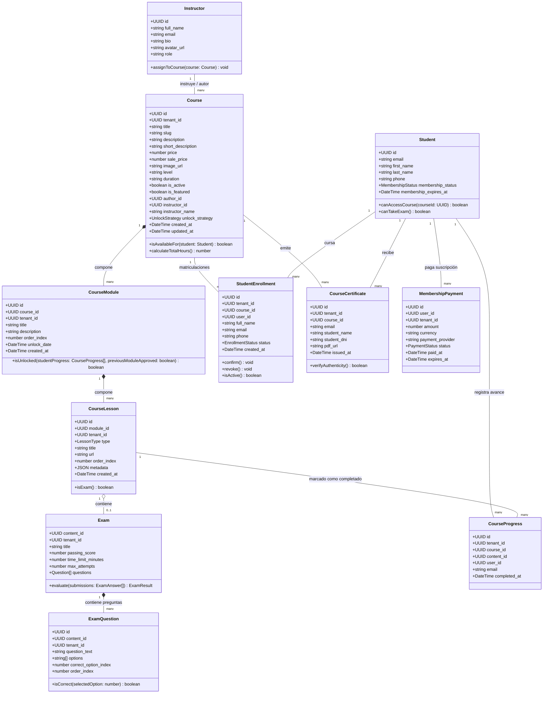
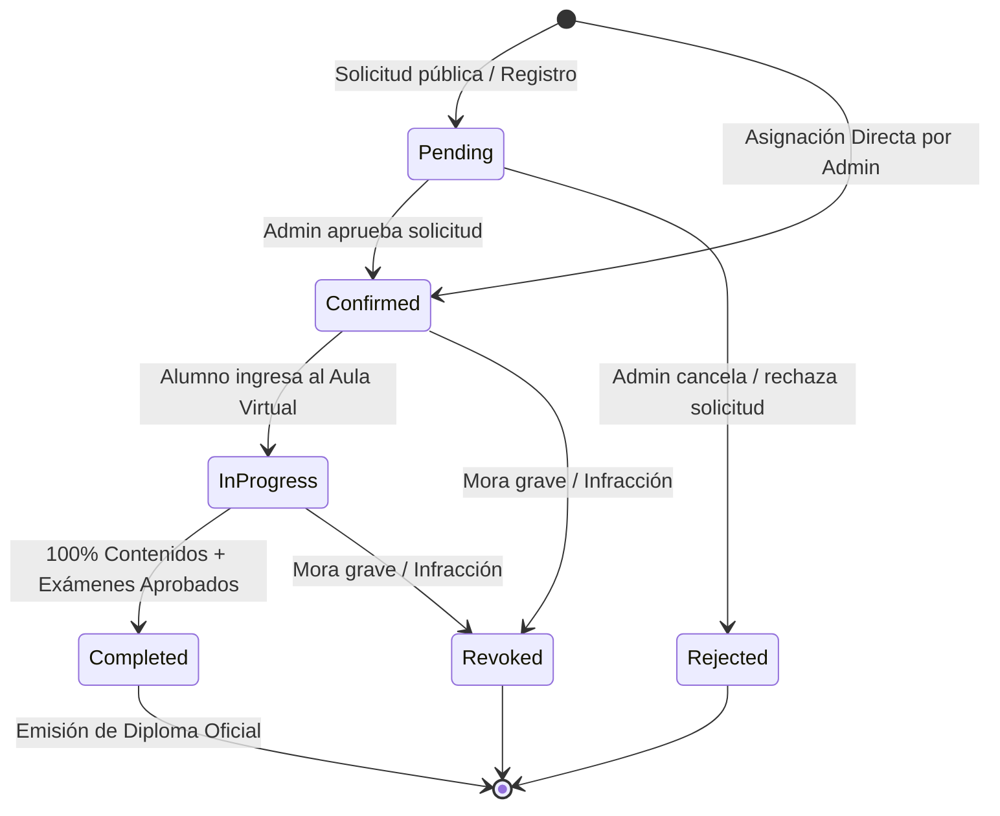
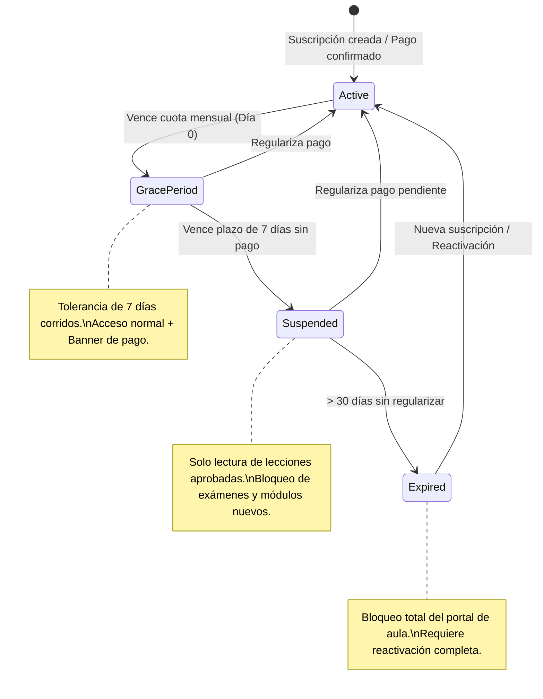
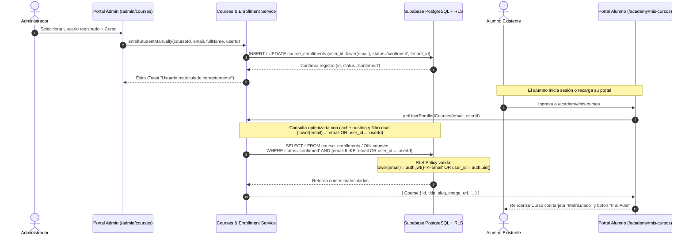

# 📐 Arecofix Academy — Modelado UML y Arquitectura de Dominio (v1.0)

Este documento modela las entidades, relaciones y transiciones de estado del sistema de Academia de Arecofix bajo principios de **Clean Architecture** y tipado estricto.

---

## 1. Diagrama de Clases (Dominio de Academia)

---

## 2. Diagramas de Transición de Estados

### 2.1 Máquina de Estados de la Matrícula (`StudentEnrollment`)

### 2.2 Máquina de Estados de Membresía del Alumno (`MembershipStatus`)

---

## 3. Diagrama de Secuencia: Asignación y Acceso de Alumno (Resolución del Bug)

