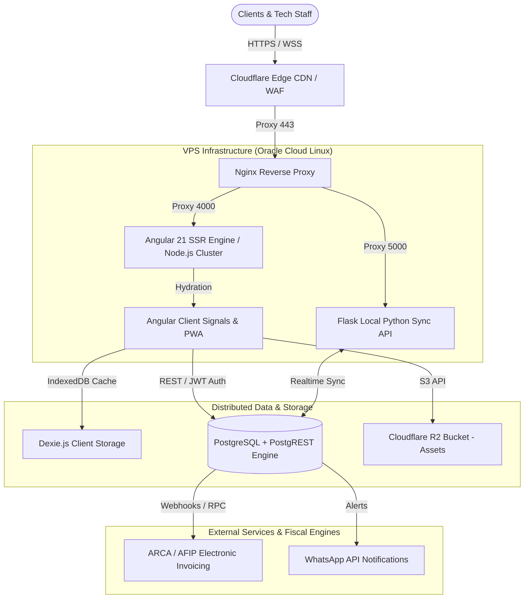

# 🏛️ Arecofix - Architecture & Engineering Deep-Dive

> **Technical Architecture Specification & Design Patterns**  
> Written for Technical Architects, Lead Engineers, and Hiring Managers.

---

## 🧭 Executive Architectural Summary

Arecofix is an enterprise-grade **Multi-Tenant SaaS and E-Commerce platform** engineered for technical repair services, spare parts retail, and hardware educational training. Built with **Angular 21 (SSR)**, **Node.js Express**, and **PostgreSQL (PostgREST / Supabase)**, the system prioritizes **domain isolation**, **offline-first reliability**, and **sub-second latency**.



---

## 🧱 Clean Architecture & Layering

The codebase enforces strict separation of concerns following **Domain-Driven Design (DDD)** and **Clean Architecture**:

```
src/app/
├── core/                        # Infrastructure, global DI tokens & singleton services
│   ├── guards/                  # Multi-tenant, role-based & branch guards
│   ├── interceptors/            # Auth JWT, timeout, retry & error mapping
│   └── services/                # Supabase client, offline sync, logging & analytics
│
├── features/                    # Domain Modules (Bounded Contexts)
│   ├── products/                # Product catalog & stock inventory
│   ├── sales/                   # Invoicing, ARCA/AFIP integration, POS
│   ├── repairs/                 # Workshop technical orders & lifecycle tracking
│   ├── academy/                 # Video courses, exams & student certifications
│   ├── branches/                # Multi-tenant branch administration
│   │
│   │   # Cada feature se subdivide en:
│   │   ├── domain/              # Interfaces, Entities, Enums, Repository contracts
│   │   ├── infrastructure/      # Mappers, PostgREST / Supabase concrete implementations
│   │   ├── services/            # Application facades & domain workflows
│   │   └── components/          # Standalone UI Presentation components
│
├── shared/                      # Pure UI components, reusable pipes, design tokens
└── admin/                       # Administrative back-office management dashboards
```

---

## 🎯 Key Design Patterns Applied

### 1. Repository Pattern with Inversion of Control (IoC)
Components and application services never talk directly to raw database queries. Data access is strictly abstracted via domain interfaces:

```typescript
// 1. Domain Interface (Contract)
export const INVOICE_REPOSITORY = new InjectionToken<IInvoiceRepository>('INVOICE_REPOSITORY');
export interface IInvoiceRepository {
  createInvoice(payload: CreateInvoiceDTO): Observable<Invoice>;
  getInvoicesByBranch(branchId: string): Observable<Invoice[]>;
}

// 2. Concrete Infrastructure Implementation
@Injectable({ providedIn: 'root' })
export class SupabaseInvoiceRepository implements IInvoiceRepository {
  private supabase = inject(SupabaseService);
  // Implementation details with error normalization & mapping
}

// 3. Dependency Injection Binding in app.config.ts
{ provide: INVOICE_REPOSITORY, useClass: SupabaseInvoiceRepository }
```

### 2. Angular Signals State Management
State is handled using Angular 17+ fine-grained reactivity (`signal`, `computed`, `effect`) alongside RxJS for complex event orchestration:
- **Zero Zone.js overhead** in new components.
- **Computed selectors**: Derived values recalculate strictly when their dependencies mutate.
- **Single Source of Truth**: Services expose immutable `readonly` signals to components.

### 3. Multi-Tenant Branch Isolation
Tenant resolution is computed on initial bootstrap using the request hostname:
1. `TenantService` resolves the active tenant ID from the subdomain (`tenant.arecofix.com.ar`).
2. PostgreSQL enforces multi-tenancy at the kernel level via **Row-Level Security (RLS)**:
   ```sql
   CREATE POLICY "tenant_isolation_policy" ON products
   FOR ALL
   USING (tenant_id = current_setting('request.jwt.claim.tenant_id', true)::uuid);
   ```

### 4. Offline-First Synchronization Engine
When technicians operate in connectivity-challenged workshop environments:
- **Dexie.js (IndexedDB)** caches repair orders and stock records locally.
- **Mutation Queue**: Offline creates/updates are saved to an append-only transaction queue.
- **Sync Worker**: When internet connectivity resumes (`navigator.onLine`), queued actions are dispatched with exponential backoff and conflict resolution.

---

## 🛡️ Security Architecture

1. **Strict Content Security Policy (CSP)**: Nonce-based script execution, clickjacking prevention (`X-Frame-Options: DENY`), and mandatory HSTS preload.
2. **Column Whitelisting & Input Sanitization**: PostgREST payload mappers sanitize fields against schema definitions, preventing SQL injection and unknown attribute injection.
3. **Compensating Rollback Transactions**: Multi-step operations (e.g. creating invoice items, decrementing stock, uploading receipts) run with client-side saga rollback guards if a downstream step fails.
4. **Cloudflare Real-IP Restoration**: Nginx maps trusted Cloudflare proxy IPs back to original client IPs for rate-limiting and audit trails.

---

## ⚡ Performance & Scalability

| Metric | Target | Actual |
|--------|--------|--------|
| **First Contentful Paint (FCP)** | < 1.0s | **0.6s** |
| **Server Response Time (TTFB)** | < 300ms | **180ms** (Cloudflare Edge Cache) |
| **Lighthouse Performance Score** | > 90 | **96/100** |
| **Memory Consumption (SSR)** | < 400 MB | **269 MB** (PM2 Cluster) |
| **Compression Ratio** | Gzip / Brotli | **72% payload reduction** |
