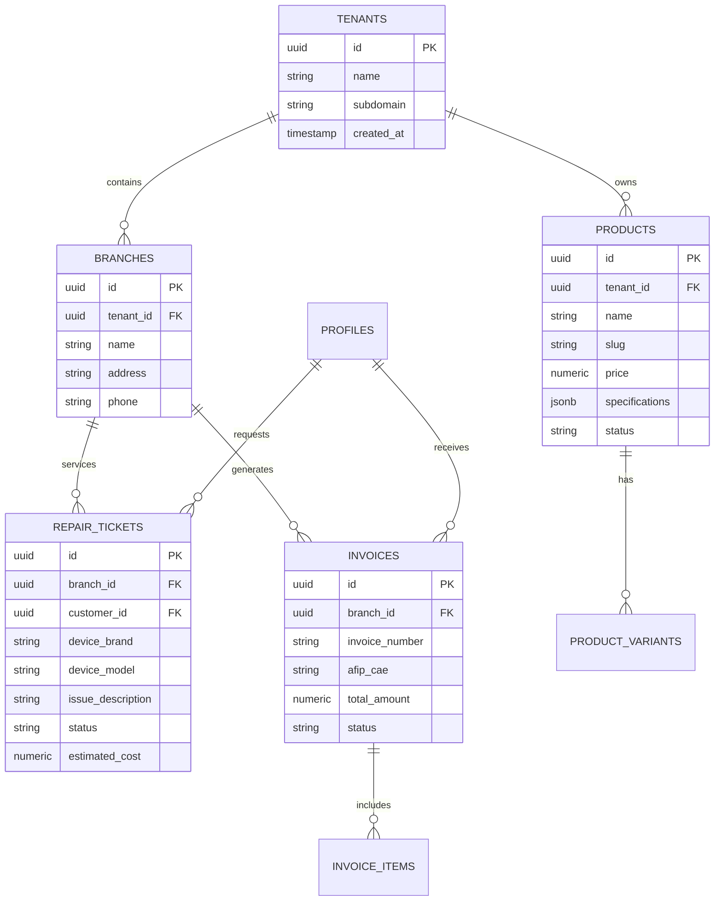

# 🗄️ Arecofix - Database Architecture & RLS Security

> **PostgreSQL, PostgREST, and Row-Level Security (RLS) Specification**  
> Connects with [SCHEMA.md](file:///c:/git/Arecofixpage/SCHEMA.md) for full SQL DDL definitions.

---

## 📐 Data Architecture Principles

The database layer runs on self-hosted PostgreSQL exposed via **PostgREST** (`db.arecofix.com.ar`), incorporating:
1. **Multi-Tenant Row-Level Security (RLS)**: Zero data leaks between tenants/branches.
2. **Strict SQL Enums & Check Constraints**: Domain rules enforced at the database kernel level.
3. **Audit Trails & Soft Deletes**: Sensitive records (sales, repairs, profiles) preserve complete history via `deleted_at`.
4. **JSONB Semi-Structured Data**: Flexible hardware specifications stored in JSONB without compromising core ACID guarantees.

---

## 🏢 Core Entities & Relationships



---

## 🔐 Multi-Tenant Row-Level Security (RLS)

All tables enforce tenant and role isolation. Queries automatically resolve the user's tenant from their JWT claims:

```sql
-- Helper function to extract tenant_id from Supabase JWT
CREATE OR REPLACE FUNCTION get_my_tenant()
RETURNS uuid LANGUAGE sql STABLE AS $$
  SELECT NULLIF(current_setting('request.jwt.claim.tenant_id', true), '')::uuid;
$$;

-- RLS Isolation Policy Example on Products
ALTER TABLE products ENABLE ROW LEVEL SECURITY;

CREATE POLICY "tenant_read_policy" ON products
  FOR SELECT
  USING (tenant_id = get_my_tenant() OR is_public = true);

CREATE POLICY "tenant_write_policy" ON products
  FOR ALL
  USING (tenant_id = get_my_tenant())
  WITH CHECK (tenant_id = get_my_tenant());
```

---

## 🛠️ Safe Migrations & Whitelisting

To guarantee data integrity across Angular and PostgREST:
- Data mappers (`product.mapper.ts`, `invoice.mapper.ts`) maintain explicit column whitelists.
- Dynamic specifications are nested inside PostgreSQL `jsonb` attributes, preventing schema drift errors (`PGRST204`).
- All migrations are tracked chronologically inside [supabase/migrations/](file:///c:/git/Arecofixpage/supabase/migrations).
