# 🚀 Arquitectura de Integración por Eventos de Dominio (EDA) — Panel Administrativo

Este documento describe la arquitectura de eventos de dominio implementada para el panel administrativo de **Arecofix**, permitiendo la comunicación reactiva y desacoplada entre módulos funcionales bajo los principios de **Clean Architecture**, **Clean Code**, **DDD táctico** y **SOLID**.

---

## 🏛️ 1. Diagrama de Eventos y Suscriptores

```mermaid
flowchart TD
    subgraph Emisores ["Módulos Emisores"]
        Purchases["Compras (/admin/purchases)"]
        Sales["Punto de Venta (/admin/sales)"]
        Orders["Órdenes Online (/admin/orders)"]
        Repairs["Reparaciones (/admin/repairs)"]
        Invoices["Facturación (/admin/sales/invoices)"]
        Suppliers["Proveedores (/admin/suppliers)"]
    end

    subgraph EventBus ["RxjsEventBusService (Singleton in-memory)"]
        PRE["PurchaseRegisteredEvent"]
        SCE["SaleCompletedEvent"]
        ODE["OrderDeliveredEvent"]
        RO_READY["RepairOrderReadyForInvoicingEvent"]
        RO_DELIV["RepairOrderDeliveredEvent"]
        IIE["InvoiceIssuedEvent"]
        SPME["SupplierPaymentMadeEvent"]
    end

    subgraph Suscriptores ["Módulos Receptores / Handlers"]
        subgraph Caja ["Movimientos de Caja"]
            C_PRE["OnPurchaseRegisteredCashHandler (Egreso si paid)"]
            C_SCE["OnSaleCompletedHandler (Ingreso)"]
            C_ODE["OnOrderDeliveredCashHandler (Ingreso)"]
            C_RO["OnRepairDeliveredCashHandler (Ingreso)"]
            C_IIE["OnInvoiceIssuedCashHandler (Ingreso si manual)"]
            C_SPME["OnSupplierPaymentMadeCashHandler (Egreso)"]
        end

        subgraph Facturacion ["Facturación ARCA"]
            F_SCE["OnSaleCompletedInvoiceHandler (Borrador si reqInvoice)"]
            F_ODE["OnOrderDeliveredInvoiceHandler (Borrador si reqInvoice)"]
            F_RO["OnRepairReadyHandler (Borrador siempre)"]
        end

        subgraph Prov ["Proveedores"]
            P_PRE["OnPurchaseRegisteredSupplierHandler (Actualiza saldo)"]
            P_SPME["OnSupplierPaymentMadeSupplierHandler (Reduce saldo)"]
        end
    end

    Purchases -->|emite| PRE
    Sales -->|emite| SCE
    Orders -->|emite| ODE
    Repairs -->|emite| RO_READY
    Repairs -->|emite| RO_DELIV
    Invoices -->|emite| IIE
    Suppliers -->|emite| SPME

    PRE --> C_PRE
    PRE --> P_PRE

    SCE --> C_SCE
    SCE --> F_SCE

    ODE --> C_ODE
    ODE --> F_ODE

    RO_READY --> F_RO
    RO_DELIV --> C_RO

    IIE --> C_IIE

    SPME --> C_SPME
    SPME --> P_SPME
```



---

## 📊 2. Matriz de Flujos (Evento → Módulo → Acción)

| Evento | Módulo Emisor | Módulo Receptor | Acción Ejecutada | Regla de Idempotencia / Restricción |
|---|---|---|---|---|
| `PurchaseRegisteredEvent` | Compras (`/admin/purchases`) | **Caja** | Crea egreso con concepto `Compra a [proveedor]`. | Solo se crea egreso si `paymentStatus === 'paid'`. Idempotencia por `purchaseId`. |
| `PurchaseRegisteredEvent` | Compras (`/admin/purchases`) | **Proveedores** | Actualiza estado de cuenta y suma al saldo pendiente si `paymentStatus === 'pending'`. | No se duplica saldo. |
| `SaleCompletedEvent` | Punto de Venta (`/admin/sales`) | **Caja** | Crea ingreso con concepto `Venta #[saleId]`. | Idempotente por `saleId`. Valida medio de pago y total. |
| `SaleCompletedEvent` | Punto de Venta (`/admin/sales`) | **Facturación** | Crea borrador de factura (estado `draft`). | **Solo si** `requestInvoice === true`. El borrador queda en `draft` para revisión humana. |
| `OrderDeliveredEvent` | Órdenes (`/admin/orders`) | **Caja** | Crea ingreso con concepto `Pedido #[orderId]`. | Idempotente por `orderId`. Mapea medio de pago y monto total. |
| `OrderDeliveredEvent` | Órdenes (`/admin/orders`) | **Facturación** | Crea borrador de factura (estado `draft`). | **Solo si** `requestInvoice === true`. Idempotente ante múltiples entregas. |
| `RepairOrderReadyForInvoicingEvent` | Reparaciones (`/admin/repairs`) | **Facturación** | Crea borrador de factura (estado `draft`) con ítems de repuestos y mano de obra discriminados. | Siempre genera borrador en `draft`. Si la orden se cancela, el borrador pasa a `voided`. |
| `RepairOrderDeliveredEvent` | Reparaciones (`/admin/repairs`) | **Caja** | Crea ingreso con concepto `Reparación #[repairOrderId]`. | Idempotente por `repairOrderId`. Registra monto efectivamente cobrado. |
| `InvoiceIssuedEvent` | Facturación (`/admin/sales/invoices`) | **Caja** | Crea ingreso con concepto `Factura #[nro]`. | **Doble contabilización prevenida:** Si el comprobante proviene de una venta, pedido o reparación (`origin !== 'manual'`), se omite porque la caja ya registró el movimiento al originarse la transacción. |
| `SupplierPaymentMadeEvent` | Proveedores (`/admin/suppliers`) | **Caja** | Crea egreso con concepto `Pago a proveedor`. | Idempotente por clave combinada única (`pay-supplierId-timestamp`). |
| `SupplierPaymentMadeEvent` | Proveedores (`/admin/suppliers`) | **Proveedores** | Reduce el saldo adeudado al proveedor por el monto pagado. | No afecta caja si ya se registró. |

---

## 💡 3. Ejemplos de Uso

### 3.1 Publicar un evento desde un módulo emisor
El emisor únicamente inyecta el `IEventBus` (inversión de dependencias) y no conoce a ningún suscriptor:

```typescript
import { inject } from '@angular/core';
import { IEventBus } from '@app/domain/events/event-bus.interface';
import { SaleCompletedEvent } from '@app/domain/events/sale-completed.event';

export class CheckoutUseCase {
  private eventBus = inject(IEventBus);

  async execute(request: CheckoutRequest): Promise<string> {
    const createdOrder = await this.orderRepository.save(order);

    // Publicación pura desacoplada
    this.eventBus.publish(
      new SaleCompletedEvent(
        createdOrder.id,
        itemsSnapshot,
        subtotal,
        discount,
        total,
        'cash',
        customerSnapshot,
        request.requestInvoice ?? false,
        new Date(),
      )
    );

    return createdOrder.id;
  }
}
```

### 3.2 Suscribirse a un evento desde un handler receptor
Cada handler encapsula una única responsabilidad (SRP), garantiza idempotencia y aísla errores:

```typescript
import { Injectable } from '@angular/core';
import { IEventBus } from '@app/domain/events/event-bus.interface';
import { SaleCompletedEvent } from '@app/domain/events/sale-completed.event';
import { CashMovementRepository } from '@app/domain/repositories/cash-movement.repository';

@Injectable({ providedIn: 'root' })
export class OnSaleCompletedHandler {
  constructor(
    private readonly cashRepo: CashMovementRepository,
    private readonly eventBus: IEventBus,
  ) {}

  register(): void {
    this.eventBus.subscribe(SaleCompletedEvent, (event) => {
      this.handle(event).catch((err) =>
        console.error('[Caja] Error procesando SaleCompletedEvent', err),
      );
    });
  }

  async handle(event: SaleCompletedEvent): Promise<void> {
    // Idempotencia por sourceEventId
    const alreadyProcessed = await this.cashRepo.existsBySourceEventId(event.saleId);
    if (alreadyProcessed) return;

    await this.cashRepo.create({
      type: 'income',
      concept: `Venta #${event.saleId}`,
      method: event.paymentMethod,
      amount: event.total,
      sourceEventId: event.saleId,
      sourceModule: 'sales',
      date: event.completedAt,
    });
  }
}
```

---

## 📐 4. Decisiones de Diseño y Principios Aplicados

1. **Clean Architecture & DDD Táctico:**
   - **Eventos de Dominio Puros:** Ubicados en `/src/app/domain/events/`. Son clases inmutables con atributos `readonly`, sin dependencias del framework ni lógica de persistencia.
   - **Snapshots Desacoplados:** Ubicados en `/src/app/domain/events/types/` (`CustomerSnapshot`, `SaleItemSnapshot`, etc.). Son estructuras autocontenidas; los suscriptores jamás consultan al módulo origen para reconstruir datos.
   - **Abstracción del EventBus:** `IEventBus` actúa como puerto en la capa de dominio, implementado por `RxjsEventBusService` en la infraestructura.

2. **SOLID & Desacoplamiento Extremo:**
   - **Single Responsibility (SRP):** Cada handler (`on-sale-completed.handler.ts`, etc.) atiende exclusivamente un evento y una reacción de su bounded context.
   - **Dependency Inversion (DIP):** Los emisores y receptores solo dependen de abstracciones (`IEventBus`, `CashMovementRepository`, `SupplierRepository`).
   - **Open/Closed (OCP):** Agregar un nuevo módulo interesado (por ejemplo, notificaciones por WhatsApp o analítica) no requiere modificar ninguno de los emisores existentes; basta con registrar un nuevo handler.

3. **Garantía de Idempotencia y Prevención de Doble Contabilización:**
   - Todos los movimientos de caja y borradores de factura almacenan su `sourceEventId` (`reference_id`).
   - Antes de ejecutar inserciones, los repositorios validan `existsBySourceEventId(id)`.
   - El suscriptor de facturación en caja discrimina facturas con origen `origin === 'manual'` de aquellas vinculadas a ventas/pedidos/reparaciones para evitar duplicar el flujo financiero.

4. **Aislamiento de Fallos en el Event Bus:**
   - La ejecución del callback de cada suscriptor se envuelve en bloques seguros de captura de errores sincrónicos y asincrónicos (`try/catch` + `.catch()`).
   - Si un suscriptor lanza una excepción, el stream de RxJS permanece activo y todos los demás suscriptores reciben su evento normalmente.

5. **Facturación Segura:**
   - La generación automática a partir de eventos produce comprobantes en estado **`draft`** (borrador pendiente de revisión), impidiendo la emisión fiscal no autorizada o desatendida ante ARCA.
