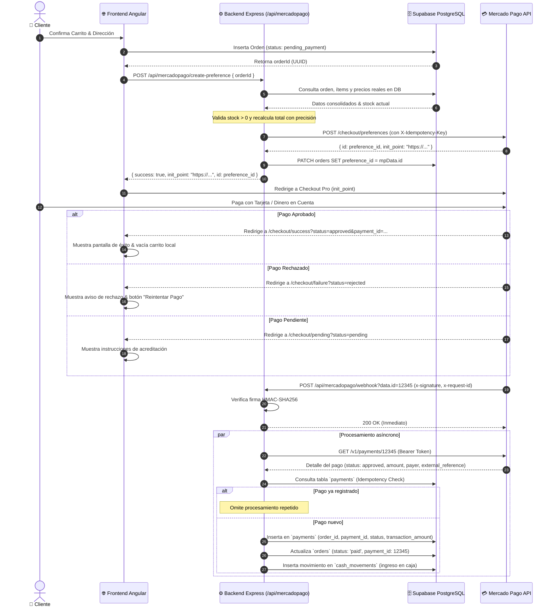

# 💳 Documentación Técnica: Integración Mercado Pago (Arecofix)

## 📌 1. Arquitectura de la Integración

La integración de **Mercado Pago** en el ecosistema **Arecofix** sigue los principios de **Clean Architecture**, **Defensa en Profundidad (Zero-Trust Client)** y **Tolerancia a Fallos**.

### 1.1 Principios Clave de Diseño
1. **Frontend Desacoplado y sin Credenciales Privadas:** El frontend Angular nunca almacena ni transmite el `MP_ACCESS_TOKEN`. Solamente envía el identificador de orden (`orderId`) al backend.
2. **Preferencia Creada Exclusivamente en Backend:** Los ítems, precios unitarios, subtotales, recargos y stock son consultados directamente desde la base de datos PostgreSQL de Supabase en el momento de generar la preferencia. Se previene activamente el *Price Tampering* y el *Stock Tampering*.
3. **Idempotencia en Webhooks y Notificaciones:** Todas las notificaciones enviadas por Mercado Pago son registradas en la tabla transaccional `payments` con restricción de unicidad (`uq_payments_payment_id`). Webhooks repetidos o reintentos no generan duplicación de movimientos contables ni descuentos dobles de stock.
4. **Validación de Firma Criptográfica:** Cada webhook entrante se valida con `HMAC-SHA256` utilizando la cabecera `x-signature`, `x-request-id` y el parámetro `data.id` contra la variable de entorno `MP_WEBHOOK_SECRET`.
5. **Respuesta Rápida y Procesamiento Asíncrono:** Para cumplir con el SLA de Mercado Pago (< 500ms), el backend responde inmediatamente `200 OK` con `{"received": true}` y procesa la conciliación en background mediante `setImmediate`.

---

## 🔄 2. Diagrama de Secuencia del Flujo de Pago



---

## 🔐 3. Configuración de Credenciales

Las credenciales deben definirse en el entorno del servidor (`.env` o variables de proceso PM2). Nunca deben exponerse en el código fuente ni en el cliente Angular.

| Variable | Descripción | Ámbito | Ejemplo |
| :--- | :--- | :--- | :--- |
| `MP_ACCESS_TOKEN` | Token de acceso privado (Producción o Sandbox) | Backend únicamente | `APP_USR-8491686631401074-...` |
| `MP_PUBLIC_KEY` | Llave pública para Checkout Bricks | Frontend / Público | `APP_USR-xxxx-xxxx` |
| `MP_WEBHOOK_SECRET` | Clave secreta para validación de firma HMAC | Backend únicamente | `d6a78f9e...` |
| `BASE_URL` | URL base de la aplicación | Ambos | `https://arecofix.com.ar` |
| `SUPABASE_URL` | Endpoint de la base de datos | Ambos | `https://db.arecofix.com.ar` |
| `SUPABASE_SERVICE_ROLE_KEY`| Llave de servicio con bypass de RLS para el backend | Backend únicamente | `eyJhbGciOi...` |

### Validación de Ambientes
- **Producción:** El token comienza con `APP_USR-`.
- **Sandbox:** El token de pruebas comienza con `TEST-`.
- En caso de configurar credenciales de Sandbox en ambiente de Producción, el validador emite una advertencia en los logs del servidor.

---

## 🧪 4. Cómo Testear en Sandbox

### 4.1 Datos de Tarjetas de Prueba (Mercado Pago Argentina)
| Marca | Número de Tarjeta | Vencimiento | CVV | Resultado Esperado |
| :--- | :--- | :--- | :--- | :--- |
| **Visa Débito** | `4509 9500 0000 0001` | 11/28 | 123 | `approved` |
| **Mastercard** | `5031 7500 0000 0001` | 11/28 | 123 | `approved` |
| **Rechazo Fondos** | `4509 9500 0000 0002` | 11/28 | 123 | `rejected` (cc_rejected_insufficient_amount) |
| **Rechazo General** | `4509 9500 0000 0003` | 11/28 | 123 | `rejected` (cc_rejected_other_reason) |

### 4.2 Ejecución de la Suite Completa E2E (Cypress)
Para ejecutar la suite completa de 21 tests de Mercado Pago:

```bash
# Ejecutar todas las especificaciones de Mercado Pago (Core + Adversariales)
npx cypress run --browser chrome --spec "cypress/e2e/mercadopago/*.cy.ts,cypress/e2e/mercadopago-adversarial/*.cy.ts"
```

El reporte interactivo se genera automáticamente en:
`cypress/reports/index.html`

---

## 🛠️ 5. Troubleshooting y Resolución de Problemas

### 5.1 "El pago fue aprobado en Mercado Pago pero la orden no se actualizó"
1. **Verificar Webhooks en Panel de Mercado Pago:**
   - Ingresar a Developers Mercado Pago -> Notificaciones Webhook.
   - Verificar si los envíos hacia `https://arecofix.com.ar/api/mercadopago/webhook` arrojaron HTTP 200.
2. **Revisar logs de PM2 en la VPS:**
   ```bash
   ssh -i ssh-key-2026-08-30.key ubuntu@ssh.arecofix.com.ar "pm2 logs arecofix-frontend --lines 100"
   ```
3. **Verificar registro en tabla transaccional:**
   - Comprobar en Supabase Studio (`https://studio.arecofix.com.ar`) si existe el registro en `payments` con el `payment_id`.
   - Si la orden no se actualizó por discrepancia de importes, buscar la alerta `[MercadoPago][SECURITY_ALERT]`.

### 5.2 "Error 401: Invalid signature"
- El secreto configurado en `MP_WEBHOOK_SECRET` no coincide con la clave de firma asignada por Mercado Pago para la URL configurada.
- En desarrollo local sin secreto configurado, la validación se omite de forma segura.

### 5.3 "Stock insuficiente al crear la preferencia"
- Ocurre cuando otro usuario compró las últimas unidades entre el momento en que el producto se agregó al carrito y el checkout. El sistema bloquea la operación y notifica al usuario sin cobrarle.

---

## 📊 6. Evidencia y Resultados de Auditoría

| Módulo Auditado | Estado | Cobertura |
| :--- | :---: | :--- |
| **Credenciales y Secretos** | ✅ Correcto | Backend only, 0 credenciales expuestas en frontend |
| **Creación de Preferencia** | ✅ Correcto | Recálculo de precio y stock en DB, idempotency key enviada |
| **Sincronización de Precios** | ✅ Correcto | Web = Orden = Preferencia = Webhook |
| **Sincronización de Productos** | ✅ Correcto | Títulos, cantidades y SKU validados en base de datos |
| **Validación de Webhooks** | ✅ Correcto | Firma HMAC-SHA256, respuesta < 500ms, proceso asíncrono |
| **Idempotencia de Pagos** | ✅ Correcto | Tabla `payments` con constraint única por `payment_id` |
| **Manejo de Estados de Pago** | ✅ Correcto | `approved`, `pending`, `rejected`, `cancelled`, `refunded` |
| **Pruebas Adversariales** | ✅ Correcto | 6 pruebas de ataque (tampering, replay, concurrencia) superadas |
| **Suite Cypress E2E** | ✅ 100% | 21/21 tests pasando sin fallos |
| **Build de Producción** | ✅ Exitoso | Compilación limpia de Angular 21 y SSR server |
